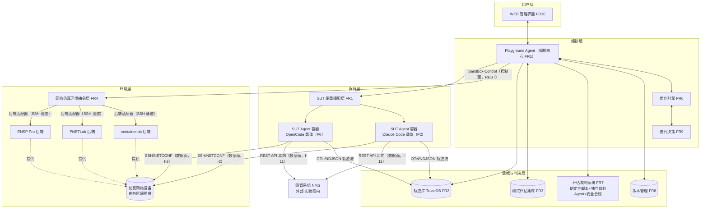

# 网络运维 Agent 的 RSI 演练场 需求分析文档

| 项目 | 内容 |
|------|------|
| 文档编号 | RSI-PG-REQ-001 |
| 版本 | v0.27（Draft） |
| 日期 | 2026-11-09 |
| 状态 | 待评审 |
| 所属项目 | rsi_playground |

> 修订记录：v0.27 — **沙箱连通性模型澄清（设计 ADR-25，2026-11-09）**：① 仿真平台（eNSP Pro/PNETLab）本身不可 SSH 登录——平台监控改为**平台 URL 探活**（3.4 通道约定重写，删除"后端宿主机 SSH 编排"表述）；② 设备 SSH 凭证=env.yaml ssh_access 每设备独立 (ip,port,用户/密码)（同 IP 不同端口复用，设备 IP 可与平台 IP 不同分别定义）；③ 拓扑生命周期=预建模式（build=平台在线校验+端点透传，快照/恢复 no-op，reset 经设备 SSH；Web API 编排 P1/S11）；④ 设备就绪=SSH 端口可达轮询 + 登录探测（FR4.6/3.4 表述同步）。v0.26 — **P0 多实例并行（设计 ADR-24，用户决策）**：NFR4/FR1.7/FR5.4 重写——P0 即支持多实验环境并行与多 SUT 实例并发（并发度可配默认 2）；**多沙箱实例模型**：各沙箱部署于不同 VM/服务器、网络名字空间独立，沙箱适配层按（网络名称, 设备名称）→ 唯一 (IP+端口) 映射 SSH 寻址（同名设备跨沙箱端点不同，天然隔离）；backends 多实例键 `<type>-<n>` P0 即用；FR1.7 拆分（P0 并行多实例 / P1 实例池复用）；P0 验收增双批次并行演示。v0.25 — 二轮交叉审查修复：①**可复现性双口径（ADR-23 对齐）**——FR4 验收/P0 验收改"客观断言判定一致 + 语义判决双跑一致率落噪声带或≥阈值"；风险表"裁判 LLM 不稳定"对策更新（温度 0/冻结/cassette/噪声带吸收）；②FR4 验收旧术语修正（"重放故障序列"→ops.jsonl 评测准备操作）；③§2.3 第 7 步补三级验证与短路；④§8 P0 范围补 FR10.9 与 FR10.5 文件编辑部分、P1 补 FR10.9⑥。v0.24 — **平台 API 与 WEB 全量补齐（设计 v2.11，用户清单 A–F + 全面扫描 G–N）**：日常全部操作经 WEB/API 完成——FR10.1 增平台参数管理（动态项热更/静态只读）、SUT 配置树文件级编辑、运行实例管理、审计日志查看；FR10.2 增迭代恢复/软删除、**P1 模式人工门操作（方向确认/假设提交/预审裁决/决策执行四端点）**、STOP 熔断恢复；FR10.4 增噪声带标定状态；FR10.5 增文件级浏览/编辑（含历史版本）与手动快照；**新增 FR10.9 运维观测**（平台日志按 run/experiment 检索、组件级健康、冻结校验状态、SFT 报告查看、跨 run 轨迹检索 P1）。v0.23 — **归因输入契约补全（设计 v2.10）：SUT 配置原文进入归因与 A/B 分类**——FR6.2 增补：归因输入除轨迹外必须包含产生该轨迹的 SUT 配置版本内容（提示词/skill/MCP/知识库原文，经版本反查 FR8.5 导出），用于区分"指引已有未执行（执行缺陷）"与"指引缺失（提示词/知识缺失）"；A/B 标注必须附原文证据引用（文件与位置）；FR6.9 补"已提供"以 SUT 原文核对为准；假设生成输入用相关要素**原文**（FR6.3 联动）。v0.22 — **判定模型重构（设计 ADR-23）：LLM 为主判决层，P0 直接实现**——FR7.2（独立裁判 Agent）P1→P0 并升为主判决层（root_cause 语义比对=期望自然语言根因描述、诊断路径质量、checklist/risk 语义命中、结论-过程一致性；pairwise 仍 P1）；FR7.1 职责缩减（设备终态断言 + critical_steps 命中 + 缺试计分；root_cause/checklist 语义判定移交 FR7.2）；FR7.4 反刷分 P0；NFR2② 修订（语义维度 LLM 为主 + 客观维度脚本判定；护栏=温度 0/提示词冻结/噪声带吸收判决方差）；期望答案 root_cause 由关键词断言改为自然语言描述 + 可选 match_hints（FR3.1/附 A）；§2.3/§8 分期与验收同步。v0.21 — **删除故障编译层（设计 v2.8，ADR-20 收尾）**：FR4.5 重写——故障类型库（FaultSpec 编译）改为**手册级命令模板**（任务以 exec_cli 直接表达故障，与断言/配置修改对称；评估集厂商绑定+专家构建，编译层无净值）；I-3 删除"注入故障/清除故障"独立操作（prepare/restore_task 已覆盖任务前后；during_task P1 再定义，直接接受 CLI 动作）；§8 P0 范围（FR4.5 限模板文档）与 P1 范围（FR4.5=任务中动态执行）同步。v0.20 — **载体轨迹通道调研核实（设计附 C）+ 载体分期调整（设计 ADR-22：OpenCode 优先 P0 单载体、Claude Code P2）**：FR1.2 重写（P0=OpenCode；Claude Code P2，I-10 接口预留）；FR2.2 重写（勘误：Claude Code OTel 实为 metrics+logs、无 span 无消息正文——P2 通道=stream-json wiretap 主+OTel events 补充+--debug-file 兜底；OpenCode=opencode-prompt-logger wire 级全文+V2 插件 hooks，已核实）；FR2.1 增配置版本重建注记；1.2 目标②/I-10/架构图/依赖表/§8 分期与验收/Q3 同步。v0.19 — **交付分期重构（设计 ADR-21）**：WEB 优化页自优化模式三级选择（P0 人工 / P1 半自动 / P2 全自动置灰至 P2 开放）；**P0 即交付 P1 半自动模式**——FR3.7（冒烟集）、FR6.2（规则归因层）、FR6.3（人工门假设）、FR6.4（人工修改+applier）、FR6.10（确定性 Critic+人工预审）、FR9.1（分级评估）、FR9.3（规则辅助人工裁决）、iterations API 提前至 P0；LLM 增强（归因精分类/假设起草）留 P1；P1/P2 分期范围与验收标准重写；P0 验收任务顺序勘误（评测准备→执行→判定→任务后恢复）。v0.18 — 命名规范联动（设计 v2.4）：3.5/3.6 轨迹与 Verdict Schema 示例值更新为时间戳格式运行态 ID（`<前缀>-<YYYYMMDDHHmmss>-<8位随机>`，UTC，见设计 2.5.C）。v0.17 — 评测准备模型重构（设计 ADR-20 联动）：评测准备以**执行手段**定义（exec_cli 直接命令行 / call_api 脚本调用外部配置 API，均多设备多命令）；故障注入与配置修改为语义目的、不再作为动作类型建模；env.yaml 新增 config_apis 段（外部 API 端点声明，集成实现）；任务后恢复按手段匹配（CLI 配置备份恢复 / API 撤销标记），置于判决之后；FR3.1/FR4.5/FR5.2/§2.3/§3.4/FR3 验收要点同步。v0.16 — 二次交叉审查修复：3.1 增实现形态说明（P0 进程内服务/拉取式采集）；3.2 挂载名统一 system-prompt.md；3.3 I-2 权限执行机制注记（ADR-14 双层）；3.5 sut_id 语义注记（纯标识、版本经 run 反查）；3.8 I-7 assign 参数与 purpose 枚举对齐数据模型；FR3.7/术语表 evolve→iterate；FR6.3 字段名 problem_trace_ids（复数）并补 defect_class；FR9.1 重判/重测 API 注记；依赖表 PostgreSQL 升级时点明确（P1 起）。v0.15 — 系统性交叉审查修复（五文档联动）：3.4 增 prepare 操作、3.5 示例值/截断残留修正、FR3/P0 验收流程顺序对齐三件套、FR4.5 时机对齐 prepare、I-1 凭证参数与 FR1.5 统一（env.ssh_access 解析）、风险表截断表述修正、"用例"→"任务"术语统一、Q6 标注已落地。v0.14 — **评估集数据模型重构（环境/任务分离）**：评估集 = 三件套（env.yaml 环境定义 + tasks.jsonl 任务集 + 设备配置文件目录）；任务一律以设备名引用（不含 IP）；SSH 登录信息集中于环境定义 ssh_access 段并支持站点覆盖（换部署环境只改接入信息）；执行侧环境一次构建、任务间快照恢复。FR3.1/3.3/3.5、FR4.3、FR1.5、术语表同步；勘误：FR6.3 预测/验证字段名 case→task 对齐（verification_task_ids / predicted_affected_tasks）。v0.13 — 取消全局节点注册表（FR5.8 模块级资源管理）。v0.12 — netmiko；自演进闭环。v0.11 — FR2.6 完整记录；FR10.8；NFR5；NFR9；命名规范。v0.10 — 部署架构调整。v0.9 — WEB 技术选型。v0.8 — 系统性评审修订：修复 FR6 表格断裂（FR6.10 归位）、3.7 交叉引用错误（FR6.6→FR6.5）、架构图数据面指向（新增仿真网络设备节点）、NFR4 与混合宿主约束矛盾、FR3.7"三分"与术语表"四分"不一致、依赖表与 Q1/Q2 表述对齐、FR4.2 去冗余；补充 NFR8 认证授权、NFR2⑤ 多源轨迹时钟对齐、NFR7 备份、FR3.1 外部依赖声明、FR4 验收/P0 验收的快照降级与双后端表述。v0.7 — 补充插桩实现机制（I-8 五阶段流水线 + 插桩副本层 + 覆盖报告）。v0.6 — 网管接入调整为 SUT 数据面直连（FR4.9/I-11 重定义）。v0.5 — 新增网管接入（后被 v0.6 修正）；架构图 SSH 通道标注。v0.4 — 引入 DGM/RRSI/OpenEvolve 机制。v0.3 — 知识库纳入优化对象；LLM 动态切换；SFT/DPO 需求评估。v0.2 — P0 后端 ENSP Pro + PNETLab；WEB 优化项选择。v0.1 — 初稿。

---

## 1. 背景与目标

### 1.1 背景

网络运维 Agent（在 OpenCode、Claude Code、Hermes 等 Agent 载体之上，通过系统提示词、Skill、MCP 工具、知识库、脚本、记忆机制等构建）正在故障定位、巡检、配置校验、割接预检等场景逐步落地。但当前其迭代仍以人工经验驱动为主：

- 提示词、Skill、工具编排的调整缺乏**量化验证手段**，改了是否有效说不清；
- 缺乏**可复现的实验环境**——网络场景无法像代码一样随手重跑；
- 缺乏**执行轨迹的完整采集**——Agent 内部推理、工具调用、上下文组装过程不透明，失败无法归因；
- 缺乏**版本管理与回滚机制**——改动耦合、无法定位单项收益、退化后难以恢复。

RSI（Recursive Self-Improvement，递归自我改进）指 AI 系统将执行经验和反馈转化为对自身能力的持久改进，形成"执行 → 评估 → 归因 → 修改 → 再执行"的自动优化闭环。2025–2026 年，RSI 已从思想实验走向工程实践：Darwin Gödel Machine 证明了"Agent 变体谱系 + 经验性验证"的可行性，ADAS 证明了"元 Agent 在代码空间自动设计 Agent"的可行性，NetPress/NetArena 证明了"仿真网络环境中动态生成评测场景"的可行性（详见 1.5 节调研映射）。

本项目的目标是建设一个**网络运维 Agent 的 RSI 演练场**：为各类网络运维 Agent 提供持续自优化、演进的基础设施环境，使其提示词、Skill、工具、知识库、记忆机制乃至 LLM 选择在可控、可复现、可度量的闭环中持续改进。

### 1.2 目标

1. **建成 RSI 全链路闭环基础设施**：覆盖测试评估集管理、网络仿真环境构建与故障注入、轨迹捕获、版本管理、评估裁判、优化迭代决策、可视化看板。
2. **支持多载体 SUT Agent 接入**：一期优先支持 OpenCode 载体构建的运维 Agent（统一容器化接入，ADR-22），预留 Claude Code（P2 接入）、Hermes、自研 SDK Agent 的适配扩展点。
3. **支持多维度优化方向与优化对象**：优化对象覆盖系统提示词、Skill、MCP 工具、程序脚本、记忆机制、**知识库**、**LLM 模型选择**；优化目标支持准确率提升、成本降低（token/调用次数）、推理延迟降低、安全合规等，支持多目标组合与跨 LLM 效果对比。
4. **分级演进**：P1 达到 L1 辅助优化（轨迹复盘 + 改进建议 + 人工合并），P2 达到 L2 自动 RSI（自动假设生成 + 沙箱自动验证 + 低风险自动晋升、高风险人工审批）。
5. **安全可控**：所有自动改动限制在白名单内、在隔离沙箱中验证、全程可回滚；裁判与评测标准冻结，杜绝评测漂移与刷分。

### 1.3 非目标（本期范围外）

- **不自动执行模型权重训练**：平台不自动启动 SFT/DPO；自 P0 起提供 SFT/DPO **需求评估与建议**能力（A/B 类缺陷分类 + 准入条件判定，见 FR6.9），训练执行列为 P3 远期方向且须人工决策；
- **不直连生产网络**：演练场与生产物理隔离；生产环境只读轨迹回流仅作为可选数据源（P3）；
- **不做无约束自改进**：不接受对沙箱边界、裁判系统、评测答案、安全规则的任何自动修改；
- **不做实时监控告警系统**：演练场是实验/优化环境，不是生产运维平台；
- **不构建网络设备镜像本身**：依赖既有仿真平台（ENSP Pro、PNETLab、containerlab 等）提供的设备仿真能力。

### 1.4 术语与定义

| 术语 | 定义 |
|------|------|
| RSI | Recursive Self-Improvement，递归自我改进：系统将执行反馈转化为对自身（提示词/技能/工具/记忆等）的持久改进，形成自动优化闭环 |
| 内环 / 外环 | 内环 = SUT Agent 执行运维任务；外环 = Playground Agent 优化 SUT Agent。两环严格分离 |
| SUT Agent | System Under Test Agent，被优化的网络运维 Agent（含载体运行时、系统提示词、Skill、MCP 工具、知识库、脚本、记忆机制、LLM 模型配置），以容器镜像形式接入 |
| Playground Agent | 演练场 Agent，编排核心：环境准备、评测执行、轨迹采集、归因分析、假设生成、修改实施、迭代决策。自身不直接操作网络设备 |
| 载体 | 构建 SUT Agent 所依赖的 Agent 框架（Claude Code、OpenCode、Hermes、自研 SDK 等） |
| 裁判系统 | 独立于内外环的评估判决组件（确定性脚本 + 独立裁判 Agent + 安全合规校验），配置冻结，不参与 RSI 迭代 |
| 测试评估集 | 三件套目录结构：仿真环境定义 env.yaml（环境名/设备清单/组网拓扑含接口类型/设备 SSH 登录信息）+ 任务集 tasks.jsonl（一行一个任务，以**设备名称**引用设备）+ 设备配置文件集；见 FR3.1 |
| 迭代集 / 主评测集 / 泛化集 / 冒烟集 | 四分评测体系：迭代集（iterate）供日常归因分析与候选预筛；主评测集（hold-out）参与版本晋升判定且版本冻结；泛化集为新增参考用例，只做参考不参与晋升判定；冒烟集（smoke）为极小活性检查子集 |
| 轨迹（Trajectory） | SUT Agent 一次执行的完整记录，含 wire 级 LLM 请求/响应原文、工具调用入出参、Skill 加载、耗时、token 等 |
| wire 级请求 | 组装完成、实际发给 LLM 的完整 payload（system + 全量 messages + tools 定义），区别于 UI 展示的对话视图 |
| 假设（Hypothesis） | 外环产出的结构化改进提案：问题轨迹引用、失败类型、改动 diff、预期收益、风险等级、验证任务 |
| 基线版本 / 候选版本 | 基线 = 当前已晋升的 SUT 快照；候选 = 应用假设改动后的 SUT 快照 |
| 晋升 / 回退 | 候选通过判决后成为新基线 / 判决不通过丢弃改动恢复基线 |
| 沙箱（Lab） | 隔离的仿真网络环境实例，可构建、快照、重置、销毁 |
| 冻结 | 对象（评测集、裁判配置）版本锁定并记录哈希，RSI 流程任何环节不得修改 |
| Reward Hacking | 刷分行为：Agent 以跳过必要步骤、利用评测漏洞等方式获得虚高分数。本系统需主动检出并拒绝 |
| L1 / L2 | L1 = 外环只做分析与建议，改动人工审核合并；L2 = 外环自动生成改动并沙箱验证，低风险自动晋升、高风险人工审批 |
| 知识库 | SUT Agent 依赖的领域知识集合（协议机理、厂商命令参考、故障案例、配置规范等文档/条目及其检索配置），属被优化对象；知识缺失是一类独立的失败模式 |
| 网管系统（NMS） | Network Management System，外部已有系统（部署于实验网内，如华为 iMaster NCE、H3C U-Center 等）；**SUT Agent 经其北向 REST API 直接查询**网络信息（告警/拓扑/状态/性能），见 FR4.9 与接口 I-11 |
| 执行节点（Execution Node） | 承载 SUT 容器和/或仿真沙箱的主机（Windows/Linux 异构），经节点间路由互通设备管理网段；由各模块（sandbox/carrier）在自身配置中**自行定义与管理**（允许跨模块重复定义，FR5.8）；主节点为 Windows（运行平台服务，可选兼作执行节点） |
| A 类 / B 类缺陷 | 缺陷分类（SFT/DPO 需求判定的分水岭）：A 类 = 表层流程缺陷，模型具备知识但执行不规范，走 Agent 侧优化；B 类 = 底层知识与推理缺陷，示例充足仍持续出错，满足准入条件后评估 SFT/DPO（详见 FR6.9） |

### 1.5 参考技术调研与本系统映射

| 技术工作 | 核心思想 | 对本系统的映射 |
|-----------|----------|----------------|
| Darwin Gödel Machine（Sakana AI，[arXiv:2505.22954](https://arxiv.org/abs/2505.22954)，ICLR 2026） | 自我改写代码的 Agent；维护 Agent 变体演化谱系（archive）；以 benchmark 经验验证替代形式化证明；冻结基座模型 | 版本管理（FR8）的谱系思想：保留变体谱系而非单一贪婪路径；整体"外环改内环 + 经验验证"范式。官方开源实现（open_source/dgm）进一步验证：补丁链表示变体 + 每变体元数据落盘 + 分级评估省算力 + "诊断→问题单→修改"两阶段改进提示词 + 分数×新颖性父代采样 |
| RRSI：Regularized Recursive Self-Improvement of Agent Harnesses（Google Research，[arXiv:2609.24972](https://arxiv.org/abs/2609.24972)，本地副本 open_source/rrsi） | 改进冻结 LLM 周围的 **harness（提示词/控制流/工具/skill/记忆/sub-agent）**而非模型权重——与本系统问题域同构；用正则化搜索防过拟合：噪声带、成本规则、非补偿守卫；Critic 静态预审六类拒绝；每个 edit 预测受影响任务并回算命中率；evolve/heldout/smoke 三分评测集；晋升=分支 fast-forward | L2 Agent-RSI 的直接先例：FR9 正则化决策规则（FR9.2/9.3）、FR6.10 Critic 预审、FR6.3 编辑预测校验、FR7.4 缺试计分规则、FR3.7 冒烟集、FR8.2 fast-forward 谱系 |
| OpenEvolve（开源演化优化引擎，[GitHub](https://github.com/codelion/openevolve)，本地副本 open_source/openevolve） | MAP-Elites 网格竞争 + 多 island 周期迁移维持多样性；LLM ensemble 多模型加权生成，生成与评估模型分离；级联评估（便宜→昂贵逐级放行）+ 超时也保 artifact；prompt 模板随机化；进程池 + 数据库快照并行；主种子→组件→每迭代请求的三段种子派生 | FR9.6 探索与多样性维持、FR9.1 分级评估、FR7.2 裁判模型 ensemble（P2 参考）、NFR2 种子派生 |
| ADAS / Meta Agent Search（[arXiv:2408.08435](https://arxiv.org/abs/2408.08435)，ICLR 2025） | 元 Agent 在代码空间迭代编程新 Agent 设计，以已发现设计的档案库为灵感 | 优化引擎（FR6）以代码/配置空间为搜索空间修改 SUT 要素 |
| Gödel Agent（[OpenReview](https://openreview.net/notes/edits/attachment?id=5iyF8XlZkH&name=pdf)） | 运行时自省内存 + 运行时自我修改；无验证机制时易自我退化 | 教训：自修改必须有独立验证——支撑裁判冻结（FR7.6）设计的必要性 |
| NetPress（Microsoft Research）/ NetArena（[arXiv:2506.03231](https://arxiv.org/pdf/2506.03231)） | 在仿真网络环境中动态生成 benchmark 场景（拓扑+故障+任务），抗过拟合/污染；K8s 内错误注入做故障排查评测 | 测试评估集（FR3）的动态场景生成（FR3.6）；仿真抽象层（FR4）的故障注入（FR4.5） |
| SIGCOMM 2025 Network Arena | 网络故障排查 Agent 评测缺失标准化基准的应对 | 评估集三类任务（故障/巡检/预检）与指标体系设计 |
| TRACE Reward Hack 基准（[arXiv:2601.20103](https://arxiv.org/html/2601.20103v1)）、METR 刷分研究 | 517 条人工核验轨迹、54 类刷分分类；前沿模型普遍存在刷分行为；轨迹对比基线可显著提升检出 | 三层判决（FR7）中裁判 Agent 的 pairwise 轨迹对比、偷步检测（FR7.4）；可审计轨迹（FR2）是前提 |
| AgenTracer（[arXiv:2509.03312](https://www.alphaxiv.org/abs/2509.03312)） | 多 Agent 系统失败归因：反事实重放 | 归因分析（FR6.2）方法参考 |
| DSPy / TextGrad | 将 prompt/程序视为可优化参数，以反馈信号自动优化 | 优化引擎（FR6）的技术储备（提示词优化策略之一） |
| Claude Code OTel 埋点 / opencode-prompt-logger | wire 级 LLM 请求/响应采集的落地通道 | 轨迹捕获（FR2.2）双载体通道选型 |
| Agent 安全工程共识（最小权限、架构性隔离优于分类器过滤） | 遏制的可靠性来自架构边界而非过滤模型 | NFR1 安全红线：沙箱隔离、白名单/黑名单、权限分级 |
| ICLR 2026 RSI Workshop、RSI Survey | RSI 从思想实验转向部署系统的趋势与风险框架 | 本文档整体风险治理（第 10 章） |

---

## 2. 系统概述

### 2.1 总体架构



**三权分立原则**：

- **内环（SUT Agent）**：执行运维任务，产出轨迹；是被修改的对象。
- **外环（Playground Agent + 优化引擎）**：分析轨迹、生成假设、实施修改、驱动迭代；自身**不直接操作网络设备**（仅通过 Sandbox-Control 控制仿真环境）。
- **裁判（评估裁判系统）**：独立判决，配置冻结，不参与迭代也不被迭代修改。

### 2.2 用户角色

| 角色 | 职责 | 主要使用界面 |
|------|------|--------------|
| Agent 工程师 | 构建/打包 SUT Agent 镜像、管理版本基线、审核改动 | WEB + CLI |
| 平台管理员 | 管理评估集、仿真后端资源、优化方向、预算与安全策略 | WEB |
| 研究人员 | 分析轨迹、假设、实验结果、收敛曲线 | WEB（轨迹查看器/看板） |
| 审批人 | 高风险改动人工审批（L2 阶段） | WEB（审批工作台） |
| 系统角色：Playground Agent | 全流程编排与优化 | API |
| 系统角色：裁判 Agent | 轨迹质量与合理性判决 | API |

### 2.3 RSI 闭环核心流程

一次完整优化迭代（外环一轮）：

1. **锁定基线**：对 SUT 当前全要素做版本快照（FR8），确认主评测集冻结版本（FR3.3）。
2. **环境准备**：Playground Agent 按评估集环境定义（env.yaml）调用 Sandbox-Control 构建仿真网络、加载设备配置（数据集级一次构建 + 基线快照），任务循环内按各任务执行**评测准备**（两种手段：直接命令行 / 脚本调用外部配置 API，多设备多命令）并于**判决之后**执行任务后恢复（按手段匹配），等待就绪探测通过（FR4/FR3.1，设计 ADR-20）。
3. **批量执行**：SUT Agent 容器按任务清单执行运维任务；全程捕获 wire 级轨迹 + 插桩事件并落库（FR1/FR2）。
4. **评估判决**：LLM 裁判主判决——根因语义比对、诊断路径质量、检查项语义命中、结论-过程一致性（FR7.2，ADR-23）；确定性脚本校验设备终态断言与证据命中（FR7.1）；安全合规扫描高危动作（FR7.3）。
5. **归因分析**：优化引擎对失败/低质量轨迹聚类，分类失败模式（调用顺序错误、漏查关键命令、推理跳步、因果错关联、幻觉命令、告警未压缩、知识缺失等），并标注缺陷类别（A 类/B 类，FR6.9），输出 Top-N 优化方向（FR6.2）。
6. **假设生成与修改实施**：生成结构化假设（单点小改动）；在白名单**且本次启用的优化项**范围内修改 SUT 要素（提示词/Skill/脚本/MCP 参数/MCP 源码/记忆机制/知识库）或切换 LLM 模型配置；修改前强制版本存档（FR6.3–6.6）。
7. **候选验证**：候选改动先过预审（FR6.10 确定性检查 + 人工门），再以候选版本执行**三级验证（ADR-21）**——冒烟集活性检查（FR3.7，失败即短路回退）→ 迭代集小子集预筛 → hold-out 主评测全量（FR9.1），与基线对比。
8. **迭代决策**：按正则化选择规则判决（FR9.3：噪声带、非补偿守卫、成本规则）——显著变好且无违规 → 晋升合并为新基线；持平或变差 → 回退；部分指标变好部分变差 → 结合历史实验记录分析后给出建议（人工或策略裁决）。回算假设的预测命中率并记入假设库（FR6.3）；失败假设入库防重复。连续 N 轮无显著收益 → 触发收敛停机或切换探索模式（FR9.4/9.6）；若失败源于 B 类缺陷且 Agent 侧优化（含知识补充、Skill 优化）连续无效 → 产出 SFT/DPO 需求评估建议，由人工决策（FR6.9）。

---

## 3. 子系统接口定义

本章定义各子系统间的接口契约。接口分两类：

- **控制面**：Playground Agent / WEB 对各子系统的管理与编排接口（REST/gRPC + SDK）；
- **数据面**：SUT Agent 与仿真网络设备间的业务访问通道（SSH/NETCONF/Telemetry）。

### 3.1 接口总览

| 编号 | 接口 | 通信方 | 协议/形式 | 章节 |
|------|------|--------|-----------|------|
| I-1 | SUT-Host API | Playground Agent ↔ SUT 承载适配层 | REST（适配层本地或 unix socket） | 3.2 |
| I-2 | 设备访问数据面 | SUT Agent ↔ 仿真设备 | SSH CLI / NETCONF / gNMI | 3.3 |
| I-3 | Sandbox-Control API | Playground Agent ↔ 仿真环境抽象层 | 对上统一 REST；适配器对后端统一走 SSH 通道（后端原生 REST API 为可选增强） | 3.4 |
| I-4 | Trace API | Playground Agent / SUT 侧采集器 ↔ 轨迹库 | REST + NDJSON 流 | 3.5 |
| I-5 | Judge API | Playground Agent ↔ 评估裁判系统 | REST | 3.6 |
| I-6 | Version API | Playground Agent / WEB ↔ 版本管理 | REST（封装 Git） | 3.7 |
| I-7 | EvalSet API | Playground Agent / WEB ↔ 评估集库 | REST | 3.8 |
| I-8 | 轨迹捕获插桩规范 | SUT 内部（由 Playground Agent 注入） | 进程内函数 + NDJSON 事件 | 3.9 |
| I-9 | Platform API | WEB ↔ Playground Agent | REST（聚合网关） | 3.10 |
| I-10 | 载体适配器接口 | SUT 承载适配层 ↔ 各载体（CC/OC/Hermes/自研） | 进程内插件接口 | 3.11 |
| I-11 | 网管北向接口 | SUT Agent ↔ 网管系统（NMS，外部） | REST API（北向，数据面，未来扩展） | 3.12 |

> **实现形态说明（P0，设计 ADR-8/11）**：I-1/I-3/I-5 的服务端以**进程内服务**形态实现（单进程 asyncio 部署），本章所列 REST 资源模型为后续部署拆分（多进程/多主机）时的演进形态；I-4 的采集通道 P0 为 **trace-collector 拉取式**（OTLP 接收 + NDJSON 文件尾随），`POST /traces:ingest` 推送通道保留给 P1/P2 远端节点 relay 使用。对 WEB 暴露的 REST 端点子集以接口文档 §9（I-9）为准。

### 3.2 I-1：SUT-Host API（Playground Agent ↔ SUT Agent 承载适配层）

Playground Agent 通过本接口管理 SUT 实例生命周期与任务下发。REST 资源模型：

| 操作 | 签名 | 说明 |
|------|------|------|
| 创建实例 | `POST /sut-instances {image_ref, config_version_id, lab_id, device_creds, permission}` → `instance_id` | 按镜像 + 配置版本实例化；`device_creds` = 由 env.ssh_access 解析的设备凭证（FR1.5）；`permission` ∈ {read-only, read-write}（默认 read-only） |
| 启动/停止 | `POST /sut-instances/{id}/start`、`/stop` | 容器生命周期管理 |
| 销毁 | `DELETE /sut-instances/{id}` | 释放容器与挂载卷 |
| 下发任务 | `POST /sut-instances/{id}/tasks {task_spec}` → `run_id` | 单任务同步/异步执行 |
| 查询任务 | `GET /runs/{run_id}` → 状态、退出码、结果摘要 | |
| 终止任务 | `POST /runs/{run_id}/abort` | 超时/异常终止 |
| 获取轨迹指针 | `GET /runs/{run_id}/trace-refs` | 返回轨迹库中的位置（run_id 关联） |

**关键约定**：

- **配置注入约定**：SUT 镜像的可修改要素不烧录在镜像内，而通过挂载卷 `/agent-config` 注入：`/agent-config/system-prompt.md`（系统提示词，与版本库文件同名直挂）、`/agent-config/skills/`（Skill 文件）、`/agent-config/mcp.json`（MCP 服务配置）、`/agent-config/memory/`（CLAUDE.md / AGENTS.md / 记忆库）、`/agent-config/scripts/`（程序脚本）、`/agent-config/knowledge/`（知识库文档与检索配置）、`/agent-config/model.json`（LLM 模型配置：provider、模型名、推理参数）。版本切换 = 替换挂载内容后重启实例。评测执行时实例实际挂载的是由配置版本**派生的插桩副本（instrumented overlay，I-8）**——插桩注入只发生在副本层，原始配置版本保持干净。
- **任务下发通道（载体相关，由载体适配器实现）**：OpenCode 载体（P0 优先）使用 `opencode run --format json` / Session API；Claude Code 载体（P2，ADR-22）使用 headless 模式（`claude -p "<task>" --output-format stream-json --verbose`）。适配器将统一 `task_spec` 翻译为载体调用。
- **凭证传递**：设备 SSH 凭证来源 = 环境定义 `ssh_access`（明文 password 仅限实验网，或 `password_ref` 引用凭证存储），解析后注入实例环境变量；网管北向 API 凭证经凭证存储注入；均不落盘于轨迹。
- **网络隔离**：SUT 实例仅加入实验专用 docker network（可达仿真设备网段 + 轨迹接收器），不可达平台管理面与其他实验环境。

### 3.3 I-2：设备访问数据面（SUT Agent ↔ 仿真网络）

SUT Agent 对仿真设备的**业务操作通道**，与演练场控制面隔离：

| 通道 | 协议 | 用途 | 权限约束 |
|------|------|------|----------|
| CLI | SSH（每设备独立账号） | display/show、配置下发（进入系统视图） | read-only 实例仅允许查询类命令；read-write 仅限特定用例且在快照环境内。执行机制=双层（设计 ADR-14）：设备账号最小权限预防（只读任务配只读视图账号）+ SafetyScanner 事后一票否决（平台不代理命令，无法在线拦截） |
| 配置读写 | NETCONF（RFC 6241，可选） | 标准化取配置/差异比对 | 同上分级 |
| 遥测 | gNMI Subscribe（可选） | 状态流采集 | 只读 |

需求：仿真后端必须保证设备 SSH/NETCONF 端口可从 SUT 实例网络可达（由 Sandbox-Control 在 build_lab 时完成组网）。

### 3.4 I-3：Sandbox-Control API（Playground Agent ↔ 仿真环境抽象层）

统一仿真环境控制接口，各后端（ENSP Pro / PNETLab / containerlab）实现适配器。

**适配器与后端之间的通道约定（设计 ADR-25 预建模式，用户澄清 2026-11-09）**：eNSP Pro/PNETLab 平台本身**不可 SSH 登录**（网页平台），双层通道——① **平台控制面=URL 探活**：平台在线监控经平台 Web 入口 URL 探测（任何 HTTP 响应=在线），不 SSH 登录平台；拓扑人工在平台网页预建，平台 Web API 编排留 P1/S11；② **设备 SSH**：初始配置下发、评测准备/任务后恢复、就绪探测、状态校验——每设备独立 (ip,port,username,password)（env.yaml ssh_access 段，同 IP 不同端口复用；设备 IP 可与平台 URL IP 不同，分别定义）。

| 操作 | 签名 | 说明 |
|------|------|------|
| 构建环境 | `POST /labs {env}` → `lab_id` | 按环境定义 env.yaml（设备/拓扑含接口类型/配置文件）构建并启动；设备端点即 env 的 ssh_access 声明（构建后验证可达）；数据集内只构建一次 |
| 销毁环境 | `DELETE /labs/{lab_id}` | |
| 重置环境 | `POST /labs/{lab_id}/reset` | 销毁后按原 spec 重建 |
| 快照 | `POST /labs/{lab_id}/snapshots {name}` → `snapshot_id` | 保存全部设备状态 |
| 恢复 | `POST /labs/{lab_id}/restore {snapshot_id}` | 回滚到快照 |
| 动态执行（P1） | `POST /labs/{lab_id}/actions {actions[]}` | during_task 任务中动态执行（直接接受 exec_cli 动作，ADR-20；契约 P1 定义——任务前/后已由 prepare/restore_task 覆盖） |
| 任务准备 | `POST /labs/{lab_id}/prepare {actions[]}` | 评测准备（ADR-20 两种手段，多设备多命令，设备名引用）：exec_cli 逐设备多条命令（执行前备份涉及设备配置）/ call_api 调用 env.config_apis 声明的外部 API（组网名+场景名+设备命令明细）；SUT 执行之前调用；配套 `POST /labs/{lab_id}/restore-task {applied[]}` 任务后恢复（判决后调用）：exec_cli=CLI 配置备份恢复、call_api=API 撤销标记重调；失败重试 ≤2 后转环境级恢复 |
| 查询拓扑 | `GET /labs/{lab_id}/topology` | 节点、链路、管理地址、状态 |
| 设备状态检查 | `GET /labs/{lab_id}/devices/{dev}/readiness` | 可达性、邻居收敛、CPU 等（环境就绪探测——设备就绪=SSH 端口可达轮询 + 登录探测（display clock），ADR-25） |
| 获取设备输出 | `POST /labs/{lab_id}/devices/{dev}/exec {cli}` | 平台侧只读诊断命令（评测校验用） |

**环境定义 Schema（env.yaml 核心，评估集三件套之一，完整示例见设计文档附 A）**：

```yaml
name: bgp-basic-env
backend: ensp-pro | pnetlab | containerlab
devices:                     # 设备清单（任务/断言以 name 引用）
  - {name: R1, type: vrp, version: "8.180", config: configs/R1.cfg}
topology:                    # 组网拓扑（含设备间接口类型）
  links:
    - {endpoints: [R1:GE0/0/1, R2:GE0/0/1], type: ethernet}
ssh_access:                  # 设备 SSH 登录（站点覆盖文件 env.<site>.yaml 仅可改本段与 backend）
  R1: {ip: 10.101.1.1, port: 22, username: admin, password: "…" | password_ref: cred-名}
ready_checks: [{type: cli_match, device: R2, cli: display ospf peer, expect: Full}]   # 缺省=全部 SSH 可达
config_apis:                # 外部配置 API 端点声明（ADR-20；实现在外部系统，本系统集成调用）
  cfg-api: {base_url: "http://…", auth_ref: cred-名}
```

任务侧（评测准备/任务描述/期望答案）在 tasks.jsonl 中逐任务定义（FR3.1），其中设备一律以名称引用。

### 3.5 I-4：Trace API（↔ 轨迹库）

| 操作 | 签名 | 说明 |
|------|------|------|
| 写入轨迹 | `POST /traces:ingest {run_id}` + NDJSON 流 | SUT 侧采集器/插桩实时上报 |
| 查询 | `GET /runs/{run_id}/traces`、`POST /traces:query {filter}` | 按任务/版本/失败类型/时间过滤 |
| 聚合 | `POST /traces:cluster {filter, group_by}` | 失败模式聚类（FR6.2 输入） |
| 统计 | `POST /traces:stats {filter}` | token、步数、耗时、调用次数分布 |

**轨迹记录 Schema（NDJSON 单事件）**：

```json
{
  "run_id": "run-20261103093015-a1b2c3d4",
  "task_id": "fault/bgp-peer-down-01",
  "lab_id": "lab-20261103090000-x7y8z9w2",
  "sut_id": "ipops-agent",
  "seq": 42,
  "ts": "2026-11-02T09:30:00.123Z",
  "event_type": "llm_request | llm_response | tool_call | tool_result | skill_loaded | knowledge_query | script_exec | error | task_end",
  "model": "…",
  "data": {
    "system": "…", "messages": [], "tools": [],
    "response": [], "usage": {"input_tokens": 0, "output_tokens": 0}
  },
  "duration_ms": 0,
  "session_id": "…", "step_seq": 0
}
```

sut_id 为纯 SUT 标识（不含版本号）；产生该轨迹的 SUT 配置版本经 run_id → runs → batches.config_version_id 反查（FR2.4/FR8.5）。要求：wire 级 `llm_request` 必须包含完整 system + messages + tools 定义；`llm_response` 为原始响应块；工具事件完整记录入参、出参与异常（不截断，FR2.6）。

### 3.6 I-5：Judge API（↔ 评估裁判系统）

| 操作 | 签名 | 说明 |
|------|------|------|
| 提交判决 | `POST /judgments {run_id, task_id, sut_id}` → `judgment_id` | 触发三层判决流水线 |
| 查询判决 | `GET /judgments/{id}` | 见 Verdict Schema |
| 批量判决 | `POST /judgments:batch {run_ids[]}` | 一轮迭代批量评估 |
| 对比判决 | `POST /judgments:pairwise {baseline_run, candidate_run}` | 裁判 Agent 对同任务新旧轨迹对比 |

**Verdict Schema**：

```json
{
  "judgment_id": "jd-20261103093200-m4n5o6p7",
  "run_id": "run-20261103093015-a1b2c3d4",
  "scores": {
    "root_cause_accuracy": 0.0,
    "task_complete": true,
    "diagnostic_steps": 0,
    "false_positive": false,
    "missed_check": false
  },
  "path_quality": {"verdict": "pass|suspect", "skipped_critical_steps": [], "reasoning": "…"},
  "efficiency": {"tokens": 0, "tool_calls": 0, "wall_time_s": 0},
  "safety": {"violations": [], "fatal": false},
  "reward_hacking_suspect": false
}
```

### 3.7 I-6：Version API（↔ 版本管理）

| 操作 | 签名 | 说明 |
|------|------|------|
| 快照当前 | `POST /versions:snapshot {sut_id}` → `version_id` | 修改前强制调用（FR6.5） |
| 提交候选 | `POST /versions:commit {base_version, changeset, hypothesis_id}` → `candidate_version_id` | changeset 为文件级 diff 集合 |
| 对比 | `GET /versions/{a}/diff/{b}` | |
| 晋升合并 | `POST /versions:promote {candidate_version_id}` | 候选成为新基线（打 tag） |
| 回滚 | `POST /versions:rollback {sut_id, version_id}` | 恢复任意历史版本 |
| 谱系 | `GET /suts/{id}/lineage` | 版本树（含每版实验证据引用） |

版本对象覆盖：系统提示词、skills/、scripts/、mcp.json、MCP 工具源码（有源码时）、memory/、以及关联的轨迹引用与实验记录。

### 3.8 I-7：EvalSet API（↔ 测试评估集库）

| 操作 | 签名 | 说明 |
|------|------|------|
| CRUD | `POST/GET/PUT/DELETE /evalsets[/{id}]` | 数据集 = env.yaml + tasks.jsonl + configs/ 三件套（FR3.1） |
| 冻结 | `POST /evalsets/{id}:freeze` | 版本锁定 + 内容哈希记录，之后禁止修改 |
| 分配 | `POST /evalsets/{id}:assign {purpose}` | purpose ∈ {iterate, holdout, generalization, smoke}（用途归属登记；SUT 与评估集的绑定由优化配置方案 profile.evalsets 承担，见配置文档 §3） |
| 场景生成 | `POST /evalsets:generate {template, params}` | P2：参数化动态生成（NetPress 式） |

期望答案 Schema 覆盖三类任务：根因结论（故障集）、检查项清单命中/漏检（巡检集）、风险识别结论（预检集），以及最终设备状态断言（供确定性脚本判定）。

### 3.9 I-8：轨迹捕获插桩规范（SUT 内部）

**插桩点类型**（记录什么）：

- **LLM 通道**：不插桩，走载体原生通道（OTel / prompt-logger，见 FR2.2）；
- **工具调用**：优先经载体原生 hook/插件机制捕获（Claude Code hooks、OpenCode 插件）；载体无此能力时经 MCP 配置包装捕获；
- **MCP 工具**：包装 MCP 服务端记录 `tool_call`/`tool_result`（入参、出参、耗时、异常），无需修改工具源码；
- **Skill**：skill 入口包装记录 `skill_loaded` + 入出参；
- **脚本**：统一 SDK 函数 `pg_trace(event)`，SUT 脚本可调用；对无源码脚本包装执行记录输入输出；
- **知识库检索**：RAG 查询/命中包装记录 `knowledge_query`（查询语句、命中条目与来源），支撑知识缺失归因（FR6.2/FR6.9）；
- 所有事件写入容器内 `/trace/events.ndjson`（镜像规范预留 `/trace/` 目录，FR1.1），由采集器上报 Trace API。

**注入机制**（如何插入——Playground Agent 扫描分析 SUT 文件系统并实施修改的五阶段流水线）：

1. **扫描发现**：扫描配置树与镜像内固定路径（`/agent-config/skills/`、`mcp.json`、`scripts/`、`knowledge/`、载体配置），盘点可插桩对象清单及各对象的载体能力（是否支持 hooks/插件、MCP 启动命令形态、脚本语言与入口）；
2. **分析决策**：对每个对象按"侵入度从低到高"选择注入方式——① **配置级注入**（不改任何文件内容，仅注入配置项：载体 hook 配置、`mcp.json` 启动命令包装 `pg-mcp-proxy -- <原命令>`、知识检索端点代理）；② **源码级注入**（LLM 分析 skill/脚本源码定位入口，插入带标记的捕获代码块 `# PG-TRACE-BEGIN … PG-TRACE-END`）；产出结构化**插桩计划**（文件清单、注入方式、捕获内容、回滚方式）；
3. **注入实施**：在**插桩副本层（instrumented overlay）**上实施——由 SUT 配置版本派生运行副本，实例挂载该副本执行；原始配置文件与版本谱系（FR8）不被插桩改动污染；
4. **冒烟验证**：注入后执行冒烟任务，校验两类结果——预期轨迹事件确实产出（skill/tool/knowledge 事件出现）；业务行为不变（冒烟集结果与未注入时一致）。任一不满足 → 告警并回滚注入；
5. **移除**：run 结束后 overlay 随实例销毁；源码级注入按标记幂等移除，配置级注入还原配置文件。

**插桩覆盖报告**：每次注入产出覆盖清单——哪些环节（LLM/工具/skill/脚本/知识库）以何种方式覆盖、哪些环节不可插桩（二进制、闭源 MCP、无源码脚本）及原因。归因分析（FR6.2）与裁判（FR7）解读轨迹时必须结合覆盖报告，避免把"轨迹不可见"误判为"行为未发生"。

**约束**：插桩不改变 SUT 业务语义（旁路只读）；注入代码统一标记、可幂等移除；插桩计划与覆盖报告随实验记录归档（FR8.4）。

### 3.10 I-9：Platform API（WEB ↔ 平台聚合网关）

REST 聚合接口，覆盖：对象管理（SUT/评估集/后端资源/优化配置方案——含优化方向与优化项勾选）、执行控制（触发评测、启动/暂停/终止优化迭代，启动时携带优化配置）、状态查询（环境、实例、任务进度）、看板数据（指标时序、版本谱系、迭代收益）。接口明细在概要设计阶段细化，本需求文档约束其功能范围（见 FR10）。

### 3.11 I-10：载体适配器接口（承载适配层内部插件）

新增载体（Hermes、自研 SDK Agent 等）接入演练场只需实现该插件接口：

```python
class CarrierAdapter(Protocol):
    def build_image(self, sut_definition) -> str: ...          # 镜像构建
    def start(self, instance, config_mount, env) -> None: ...  # 启动载体运行时
    def submit_task(self, instance, task_spec) -> RunHandle: ... # 任务翻译与下发
    def collect_result(self, handle) -> TaskResult: ...        # 结果回收（结构化输出约定）
    def trace_channels(self, instance) -> TraceChannel: ...    # 轨迹通道（OTel endpoint / NDJSON 路径 / SDK 钩子）
```

一期（P0）交付 `OpenCodeAdapter`（优先载体）；`ClaudeCodeAdapter` P2 交付（插件接口不变，ADR-22）。

### 3.12 I-11：网管北向接口（SUT Agent ↔ 网管系统，数据面，未来扩展）

**性质**：SUT Agent 的数据面通道（与 I-2 设备访问同类）——SUT 以与生产运维一致的方式，经北向 REST API 直接查询外部网管系统（NMS，如华为 iMaster NCE、H3C U-Center 等），获取告警列表、拓扑、设备状态、性能数据。查询由 SUT 自身的 MCP 工具发起；抽象层不代理、不转存网管数据。

**平台职责**（三项）：
1. 网络可达：SUT 实例网络策略放行用例声明的网管端点（配合 FR1.6）；
2. 凭证注入：网管北向 API 凭证经 `credentials_ref` 注入（不落盘轨迹）；
3. 依赖声明与就绪探测：评估集用例可声明 NMS 依赖（端点/接口版本），就绪探测阶段验证 SUT 侧可达。

**约束**：① 网管为外部已有系统（部署于实验网内），演练场不负责部署与控制；② SUT 侧以北向查询类（只读）接口为主；③ 若接入对象为生产网管，与 NFR1（演练场与生产隔离）冲突，须作为受控例外单独安全评审（参照 P3 生产只读回流的治理要求），数据须先脱敏（FR2.7）。

---

## 4. 功能需求

优先级标注：**P0** = 基础设施期必须；**P1** = L1 辅助优化期；**P2** = L2 自动 RSI 期。

### FR1 SUT Agent 承载适配层

| 编号 | 需求 | 优先级 |
|------|------|--------|
| FR1.1 | **SUT 容器镜像规范**：SUT Agent 打包为 OCI 镜像，内含载体运行时；可修改要素（系统提示词、Skill、MCP 配置、记忆、脚本、知识库、LLM 模型配置）通过 `/agent-config` 挂载注入，镜像本身与配置版本解耦；镜像内预留 `/trace/` 轨迹输出目录（卷挂载，供插桩事件与采集器使用）。**镜像接入（v0.27）**：P0=本地镜像（`docker save/load` 导入主节点 Docker Desktop + WEB 创建 SUT 时填写 image_ref + "验证镜像"按钮检查规范：载体 CLI 可执行//trace/ 目录/插件预装）；P1=私有 registry 对接（Harbor/Nexus，WEB 浏览拉取） | P0（本地镜像+验证）/P1（registry） |
| FR1.2 | **载体支持（OpenCode 优先，ADR-22）**：P0 支持 OpenCode 载体（`opencode run --format json` + opencode-prompt-logger wire 级采集 + `@opencode/plugin` V2 插件插桩）的 SUT 接入运行；Claude Code 载体（headless `-p` + stream-json wiretap + OTel events 补充）P2 接入（I-10 适配器接口预留，实施事实见设计附 C） | P0（OpenCode）/P2（Claude Code） |
| FR1.3 | **载体适配器接口**：定义 I-10 插件接口，新增载体不改平台核心 | P0 |
| FR1.4 | **配置版本热切换**：切换 SUT 配置版本 = 替换挂载 + 重启实例，无需重建镜像 | P0 |
| FR1.5 | **凭证与权限注入**：设备凭证来源 = 环境定义 ssh_access（明文密码仅限实验网，或 `password_ref` 引用凭证存储）；网管（NMS 北向 API）凭证经凭证存储注入；实例级 read-only/read-write 权限开关，默认只读 | P0 |
| FR1.6 | **实例网络隔离**：SUT 实例仅可达本节点 lab 网段、经节点间路由可达的远端设备网段（FR5.8）、轨迹接收器及用例声明的网管端点（I-11），禁止触达平台管理面与其他实验 | P0 |
| FR1.7 | **并行实例**：P0 支持多 SUT 实例并发执行（每 run 一实例，多实例并存，v0.26/ADR-24）；P1 实例池复用（同版本实例复用降低启动开销） | P0（并行）/P1（池化） |
| FR1.8 | **LLM 配置外置与动态切换**：SUT 使用的 LLM（provider、模型名、推理参数）通过 `/agent-config/model.json` 外置于配置版本，不重建镜像即可切换并重启生效；载体适配器负责翻译为载体模型参数（如 Claude Code `--model`/模型环境变量、OpenCode provider 配置）；配合 FR9.1 支持同一评测集上的跨 LLM 对比实验——模型选择本身即一类优化对象 | P0 |

验收要点：同一 SUT 镜像 + 两个不同配置版本，可通过挂载切换分别启动并产出可区分轨迹；OpenCode 载体跑通示例 SUT（Claude Code 载体 P2 交付，ADR-22）。

### FR2 轨迹捕获与轨迹库

| 编号 | 需求 | 优先级 |
|------|------|--------|
| FR2.1 | **wire 级 LLM 采集**：记录每次 LLM 调用的完整请求（system + 全量 messages + tools 定义）与原始响应，禁止仅存 UI 对话视图；system 与 tools 部分可由平台注入的配置版本重建（FR1.1，平台已知） | P0 |
| FR2.2 | **载体原生通道（附 C 已核实）**：OpenCode（P0）= opencode-prompt-logger wire NDJSON（`assembled`=system+messages+tools 全文、`http`=原始 provider body；插件 `file` 选项按 run 落 `/trace/wiretap/<run_id>.ndjson`）+ `@opencode/plugin` V2 hooks（tool.execute.before/after）；Claude Code（P2）= stream-json 全流 wiretap（主通道）+ OTel events（`CLAUDE_CODE_ENABLE_TELEMETRY=1` 等环境变量全集，metrics+logs 协议、无消息正文）+ `--debug-file` 兜底；wire 级请求 = 配置版本（system+tools）+ wiretap（messages） | P0（OpenCode）/P2（Claude Code） |
| FR2.3 | **插桩采集**：按 I-8 规范对工具调用/skill/脚本/知识库检索注入捕获（入出参、耗时、异常）；注入方式与流水线见 I-8（配置级优先，源码级带标记可幂等移除） | P0（MCP 配置包装级）/P1（源码级与知识库检索） |
| FR2.4 | **轨迹 Schema 与存储**：3.5 节 Schema；NDJSON 明文 + 元数据索引库；每条事件与 run_id/task_id/lab_id/SUT 版本关联 | P0 |
| FR2.5 | **查询与聚类**：按任务、失败类型、版本、时间检索；失败轨迹聚类供归因分析 | P1 |
| FR2.6 | **完整记录与存储管理**：所有轨迹事件**完整记录**相关调用的输入/输出全文（wire 级 LLM 请求/响应、工具调用入出参、设备命令输出），**不做内容截断**；逐事件时间戳（NFR2⑤）；存储压力仅通过压缩归档与老化策略管理，不影响在线实验数据的完整性 | 完整记录 P0；存储管理 P1 |
| FR2.7 | **敏感信息脱敏**：轨迹中的凭证/密钥按策略掩码后再入库 | P1 |

验收要点：一次 SUT 执行后，可在轨迹库中还原完整时序：每个 LLM 请求的 system prompt 与 messages、每次工具调用入出参、每次 skill 加载，且与仿真环境 lab_id、任务 task_id 关联。

### FR3 测试评估集管理

| 编号 | 需求 | 优先级 |
|------|------|--------|
| FR3.1 | **评估集三件套结构**：一个评测数据集 = ① **仿真环境定义文件**（YAML：环境名、仿真后端、设备清单（名称/类型/版本/配置文件名）、组网拓扑（含设备间接口类型）、设备 SSH 登录信息（IP/端口/用户名/密码或凭证引用）、外部配置 API 端点声明 config_apis）+ ② **评测任务集文件**（JSONL，每行一个任务：**评测准备——按执行手段定义两种形式，均支持多设备、每设备多条命令**：直接命令行（逐设备命令序列，由抽象层经 CLI 执行）/ 脚本调用（经环境定义 config_apis 声明的外部配置 API 执行，参数含组网名、评测场景名、设备与命令行明细；API 实现在外部系统，本系统集成调用）；注入故障/配置修改等为语义目的、由命令内容体现，不作为动作类型建模（设计 ADR-20）；另含任务描述（输入、上下文、可用工具约束）、期望答案（**根因=自然语言描述 + 可选 match_hints（报告高亮用，不作判据）**、检查项/风险判定、设备终态断言——语义判定由 LLM 裁判执行，ADR-23）、指标；**任务中一律以设备名称引用设备，不含 IP**）+ ③ **设备配置文件集**（目录，按设备名组织）；支持外部依赖声明（如 NMS 端点，见 I-11）；**SSH 接入信息集中于环境定义的 ssh_access 段，支持站点覆盖文件**——换部署环境（如 ENSP Pro → PNETLab）只改 backend 与接入信息，拓扑/任务/配置文件不动 | P0 |
| FR3.2 | **三类任务**：标准故障集（BGP 邻居 Down、OSPF 异常、路由黑洞、MTU 不匹配、ACL 丢包、VRF 泄露、STP 环路、EVPN VXLAN 等）、巡检任务集、割接预检集 | P0 |
| FR3.3 | **主评测集冻结**：hold-out 主评测集版本化 + 三件套整体内容哈希锁定，RSI 迭代任何环节不可修改标准答案（站点覆盖文件仅允许覆盖 backend/ssh_access，不得触碰任务与期望答案） | P0 |
| FR3.4 | **泛化参考集**：新增故障用例仅入泛化集，只作参考展示，不参与晋升判定 | P1 |
| FR3.5 | **用例版本化与导入导出**：三件套（env.yaml / tasks.jsonl / configs/）以原格式 git 管理并支持导入导出 | P0 |
| FR3.6 | **动态场景生成**：参数化模板生成拓扑/故障变体（NetPress 式），扩充泛化集，抗过拟合 | P2 |
| FR3.7 | **冒烟集（smoke set）**：极小快速用例子集（每域 3–5 条），用于候选改动应用后的"活性检查"——确认 SUT 基本可用（未因改动崩溃/超时/全面失败）后才进入全量评估；与迭代集（iterate，日常优化用）、hold-out 主评测集（晋升判定用）、泛化集（新增参考用）共同构成四分评测体系（见术语表） | P0（ADR-21） |

验收要点：给定一个评估集三件套，可完整驱动：构建环境（一次）→ 就绪检查 → 逐任务（评测准备 → 下发任务 → 按期望答案判定 → 任务后恢复（按手段匹配，确保前任务配置不影响后续任务））。

### FR4 网络仿真环境抽象层

| 编号 | 需求 | 优先级 |
|------|------|--------|
| FR4.1 | **统一 Sandbox-Control 接口**：3.4 节全部操作 | P0 |
| FR4.2 | **后端适配器**：ENSP Pro 适配器（P0，华为 VRP 原生，设备 SSH 登入已验证）+ PNETLab 适配器（P0，多厂商镜像，设备 SSH 登入已验证）；containerlab 适配器（P1，拓扑即代码、CI 自动化补充）；适配器与后端的通道约定见 3.4（SSH 为主、REST API 可选增强）；后端能力差异在适配器内消化 | P0/P1 |
| FR4.3 | **环境构建自动化**：按环境定义（env.yaml）自动创建节点、布线（含接口类型）、加载设备配置文件；设备端点即 env 的 ssh_access 声明，构建后经验证可达（不一致即环境错误） | P0 |
| FR4.4 | **快照/恢复/重置**：全部设备状态可快照、可回滚、可重建——评测可复现的核心 | P0 |
| FR4.5 | **故障场景支持（手册级命令模板，v0.21 无编译层）**：常用故障（链路中断=双端接口 shutdown、接口 down、错误配置注入、ACL 丢包、路由黑洞、邻居闪断等）的**命令模板以手册/示例文档提供**（docs/manual/user-guide，随版本维护）——任务以 exec_cli 直接表达故障（与断言/配置修改对称、所见即所执行，设计 ADR-20）；任务中动态执行（during_task）经 Sandbox-Control 直接接受 CLI 动作，契约 P1 定义 | P0（模板文档）/P1（任务中动态执行） |
| FR4.6 | **就绪探测**：设备可达性（SSH 端口可达轮询 + 登录探测）、协议收敛检查通过后才放行 SUT 执行 | P0 |
| FR4.7 | **资源回收**：环境超时自动销毁、实验结束自动回收 | P0 |
| FR4.8 | **环境隔离**：各 lab 独立网络平面，互不可达 | P0 |
| FR4.9 | **网管接入（外部 NMS 数据面，未来扩展）**：外部已有网管系统（实验网内）接入演练场，SUT Agent 经北向 REST API 直接访问（数据面，接口 I-11，见 3.12）；平台仅保障网络可达、凭证注入与用例依赖声明/就绪探测，抽象层不代理、不转存网管数据 | P2 |

验收要点：同一用例连续两次构建-执行——**客观断言（终态/安全/critical_steps）判定一致，语义判决双跑一致率落入噪声带或 ≥ 可配阈值**（ADR-23 双口径可复现性）；评测准备（故障注入/配置修改）生效后设备状态符合预期；快照恢复后设备状态与快照点一致（快照 API 受限的后端允许降级实现：reset 重建 + 重放初始配置与评测准备操作 ops.jsonl（ADR-20），验证等价性）。

### FR5 Playground Agent（编排核心）

| 编号 | 需求 | 优先级 |
|------|------|--------|
| FR5.1 | **评测流程编排**：环境准备 → 就绪探测 → SUT 执行 → 轨迹回收 → 提交判决 → 结果落库，全流程自动 | P0 |
| FR5.2 | **环境搭建执行**：按评估集环境定义（env.yaml）调用 Sandbox-Control 完成搭建与配置加载（数据集级一次），任务级执行评测准备（两种手段，设计 ADR-20）与**任务后恢复**（按手段匹配：直接命令行=配置备份恢复；脚本调用=API 撤销；置于判决之后，环境级快照为兜底） | P0 |
| FR5.3 | **插桩管理**：扫描分析 SUT Agent 文件系统，按 I-8 五阶段流水线执行——发现可插桩对象 → 生成结构化插桩计划（配置级注入优先，源码级注入由 LLM 定位入口并加标记）→ 在插桩副本层实施 → 冒烟验证（事件产出 + 行为不变）→ 用后移除；产出插桩覆盖报告（含不可插桩环节及原因） | P0（MCP 配置包装等配置级）/P1（全自动扫描与源码级注入） |
| FR5.4 | **批量执行调度**：评测集批量跑、失败重试、并发控制（任务级与批次级并发度可配，默认 2，v0.26/ADR-24；沙箱实例按（网络名,设备名)→(IP+端口) 映射寻址，跨沙箱天然隔离） | P0（并发可配） |
| FR5.5 | **异常处理与断点续跑**：环境构建失败自动重建（有限次）、SUT 超时终止、任务异常捕获不中断整批；评估产物按任务缓存落盘，迭代中断后可从断点恢复（不重跑已完成任务）；支持外部停机开关（STOP）即时熔断 | P0（基础异常处理）/P1（断点续跑） |
| FR5.6 | **资源预算执行**：按预算配置监控单轮迭代的 token/时长/费用，超限熔断 | P1 |
| FR5.7 | **任务模板**：Playground Agent 自身也是 LLM Agent，其提示词/流程模板平台化管理（但**不属于** SUT 优化对象，版本独立管理） | P1 |
| FR5.8 | **模块级资源管理**：各模块在自身配置段内定义并管理所需资源——sandbox 定义仿真后端（主机/SSH 接入/后端参数/设备网段池，含就绪探测与健康检查），carrier 定义执行主机（Docker 接入方式/网段池，含可达性检查）；同一物理主机允许多模块**重复定义**（模块解耦约定，不设全局节点注册表）；跨模块的网段全局唯一性由部署规划与部署时校验脚本保证（Q10，不依赖运行时注册）；P2——各模块内自动资源选择（多后端实例/多主机的负载与能力过滤） | P0（资源定义/就绪探测/部署校验）/P2（模块内自动选择） |

验收要点：一条命令（或 WEB 一次点击）驱动完整评测批次并产出全部判决结果与轨迹。

### FR6 优化引擎

| 编号 | 需求 | 优先级 |
|------|------|--------|
| FR6.1 | **优化方向与优化项设定**：① 优化目标配置——准确率/成本/延迟/安全及权重，多目标组合；② **优化项选择**——按修改白名单勾选启用/禁用本次迭代允许被优化的项（系统提示词、Skill、程序脚本、MCP 调用参数、MCP 工具实现、记忆机制、知识库、LLM 模型配置），未勾选项在假设生成与修改实施中被强制排除（执行层校验）；支持保存为可复用的优化配置方案 | P0（配置与选择，经 WEB）/P2（自动多目标权衡） |
| FR6.2 | **轨迹归因分析**：失败/低质量轨迹聚类与失败模式分类（调用顺序错误、漏查关键命令、推理跳步、因果错关联、幻觉命令、告警未压缩、YANG/路径错误、**知识缺失**——知识库未覆盖所需协议机理/厂商命令等），并区分缺陷类别（A 类表层流程缺陷 / B 类底层知识缺陷，FR6.9），输出 Top-N 优化方向。**归因输入除轨迹外必须包含产生该轨迹的 SUT 配置版本原文**（提示词/skill/MCP 配置/知识库，经 run→config_version 反查导出，FR8.5）——对照原文区分"指引已有未执行（执行缺陷）"与"指引缺失（提示词/知识缺失，优化方向明确）"；**A/B 标注必须附原文证据引用**（文件与位置——FR6.9"已提供仍出错"的可判定依据）；**归因输入同时包含该 SUT 的近期优化历史**（opt_history：轮次/提案类型/决策/失败模式/原因——标注"此簇已尝试 X 未果，建议换方向"，Top-N 排序排除已证明无效方向、优先有效方向，防重复失败优化） | P0（规则聚类层含原文对照+历史输入，ADR-21）/P1（LLM 精分类） |
| FR6.3 | **结构化假设生成**：输出假设 JSON（problem_trace_ids、failure_type、defect_class ∈ {A,B}、proposal_type ∈ {modify_prompt, add_runbook, adjust_tool_sequence, add_fewshot_example, add_knowledge, switch_model, …}、diff_content、expected_improve、risk、verification_task_ids、**predicted_affected_tasks——预测将被该改动改善的任务清单（task_id）**）；生成采用两阶段模式（先诊断失败证据、产出结构化问题单，再按问题单实施修改，参考 DGM/RRSI 实践）；决策阶段回算**预测命中率**记入假设库，用于评估假设质量与反过拟合；P0 人工门表单生成（预测清单可手填），P1 LLM 起草增强，P2 自动 | P0/P1/P2（ADR-21） |
| FR6.4 | **修改实施**：在白名单**且本次启用的优化项**范围内修改 SUT 要素——系统提示词、Skill、程序脚本、MCP 调用参数模板、MCP 工具内部实现（仅限本地有源码的 MCP）、记忆机制（CLAUDE.md/AGENTS.md/记忆库）、知识库（文档/条目/检索配置），以及 LLM 模型配置切换（模型选择）；P0 由人工按建议修改（staging worktree + applier 校验提交），P2 引擎自动实施。U7b 注记（2026-11）：可按 SUT 显式定义 `optimization_scope` 将 RSI 自动优化进一步收窄至指定路径（critic/applier 执行层强制；未定义=平台扫描自动决定=现状；人工编辑不受 scope 限制） | P0/P2（ADR-21） |
| FR6.5 | **修改前强制存档**：任何修改前自动调用 Version API 快照当前版本 | P0 |
| FR6.6 | **单点修改约束**：一次假设只允许一处单点修改（Prompt、Runbook、知识条目、工具参数、模型配置择一），禁止耦合改动 | P2 |
| FR6.7 | **高风险人工预审**：涉及配置下发逻辑等高风险改动，须人工审批后才能进入沙箱测试 | P2 |
| FR6.8 | **失败假设库**：被拒绝的假设入库（含拒绝原因、预测命中率回算结果），后续生成时避免重复（可用语义相似度辅助去重） | P2 |
| FR6.9 | **模型训练（SFT/DPO）需求评估——只建议、不执行**：判定缺陷是否属于模型底层短板、是否需要启动 SFT/DPO：① **A 类缺陷（表层流程缺陷）**：模型具备对应知识但执行不规范——故障排查漏查采集步骤、跳过证据收集直接下结论、无法结构化提取字段（VRF/RD/RT 等）、输出格式不可解析等 → 走 Agent 侧优化（提示词/Few-shot/工具编排约束/知识库补充/检查规则），**不启动 SFT**；② **B 类缺陷（底层知识与推理缺陷）**：已提供完整 Prompt、标准排查步骤与充足正确示例仍持续出错（**"已提供"以 SUT 配置原文核对为准，B 类标注附原文证据引用——文件与位置**）——反复示例仍幻觉华为 VRP 命令/NETCONF XPath 路径、无法理解 EVPN NLRI/VXLAN 控制面输出、RT/VNI 映射与协议机理持续理解错误、Telemetry/YANG 结构化解析在规则与示例补充后泛化仍失效 → 满足准入条件后评估 SFT/DPO；③ **准入条件（须全部满足）**：该缺陷类别的 Agent 侧优化（含知识补充与 Skill 优化）已连续 N 轮无显著收益；失败轨迹样本量达到训练集构建门槛；成本与风险可接受；④ **输出**：SFT/DPO 建议报告（缺陷类别与证据轨迹集、候选训练样本清单、预期收益、风险），由人工决策；平台**不自动启动任何模型训练** | P0（A/B 分类框架 + 模板化人工评估报告）/P1（归因驱动的半自动分类）/P2（阈值自动判定与建议生成） |
| FR6.10 | **候选改动静态预审（Critic）**：候选 diff 进入沙箱执行前先做静态预审——① 确定性检查：是否触碰黑名单路径（裁判/评测标准答案/安全规则/凭据文件）、是否越界修改未启用优化项的文件；② LLM 审查至少覆盖六类拒绝理由：删除或削弱已有安全机制、针对评测集的定向作弊（grader gaming）、无效改动（no-op）、无界循环或资源失控、未声明的捆绑改动（夹带无关修改）、破坏任务中止/放弃路径；被拒绝的候选可自动修复后重新提交预审（有限轮次，默认 ≤5 轮）；仍不过关或命中高风险类别的转人工审批（衔接 FR6.7） | P0（确定性检查 + 人工预审门，ADR-21）/P2（LLM 六类审查自动化） |

**修改白名单（允许）**：系统提示词与分场景诊断 Prompt、Skill/Runbook/排查模板、Few-shot 示例库、命令输出解析规则、MCP 工具调用编排（顺序/重试/超时/参数模板）、MCP 工具内部实现（有源码时）、记忆机制（记忆文件内容与组织）、知识库（文档/条目/检索配置）、LLM 模型配置（provider/模型/推理参数的选择）。

**修改黑名单（绝对禁止）**：裁判系统与评估脚本、主评测集标准答案、沙箱环境与安全熔断规则、设备账号权限与 ACL、平台自身（Playground Agent 提示词与流程、版本管理数据）、生产网络。

### FR7 评估与裁判系统

| 编号 | 需求 | 优先级 |
|------|------|--------|
| FR7.1 | **确定性客观判定**（ADR-23 职责缩减）：脚本校验设备**最终状态**断言（final_state：路由表/邻居/接口/配置差异的 expect_contains/expect_absent）与 critical_steps 证据命中计数，输出结构化分数；**语义判定（根因比对/检查项命中）不由本项承担**（归 FR7.2 LLM 裁判） | P0 |
| FR7.2 | **独立裁判 Agent（主判决层，P0，ADR-23）**：固定裁判模型（温度 0、提示词冻结）执行**语义判定**——① 根因语义比对（期望=自然语言根因描述 ↔ SUT 结论，同义表述判对）；② 诊断路径质量判决（路径合理性、因果链正确性、偷步嫌疑）；③ 巡检/预检语义命中（checklist/risk_findings 漏检/误报）；④ 结论-过程一致性（蒙对判不过）；pairwise 新旧对比 P1；裁判不参与迭代、不被修改 | **P0**（pairwise P1） |
| FR7.3 | **安全合规校验**：扫描全部动作序列，检出高危操作（清空配置、错误 ACL/路由下发、闪断邻居、越权命令）、熔断规则触发 | P0 |
| FR7.4 | **反刷分检测**：偷步检测（跳过必要排查步骤）、结论-过程一致性校验（蒙对结论但路径错误判不通过）；缺试防刷分——任务未完成/放弃/超时计 0 分且**不从分母剔除**（防止放弃难题刷高均分） | P0（ADR-23：随 LLM 裁判提前） |
| FR7.5 | **判决输出**：Verdict Schema（3.6 节），安全违规一票否决 | P0 |
| FR7.6 | **裁判冻结**：裁判配置、评估脚本、标准答案内容哈希锁定并记录于版本管理，任何 RSI 环节无修改权限 | P0 |

### FR8 版本管理

| 编号 | 需求 | 优先级 |
|------|------|--------|
| FR8.1 | **版本对象全覆盖**：SUT 全要素（提示词/skill/脚本/MCP 配置/MCP 源码/记忆/知识库/LLM 模型配置）+ 评估集 + 裁判配置的版本化，全部纳入 Git；插桩副本层（I-8）为 run 级派生产物，不入版本谱系 | P0 |
| FR8.2 | **基线谱系**：分支/tag 模型表达"基线 → 候选 → 晋升/丢弃"谱系（基线晋升可实现为分支 fast-forward），可视化 lineage；所有候选（含被拒绝的）均归档不删除（keep-all），初始基线恒在档，供回溯与探索模式重选父代 | P0（可视化 P1） |
| FR8.3 | **diff / 合并 / 回滚**：任意两版本文件级 diff；候选晋升合并；一键回滚至任意历史版本 | P0 |
| FR8.4 | **实验记录归档**：每次迭代的假设、改动 diff、判决结果、决策及证据链（轨迹引用）完整归档 | P0 |
| FR8.5 | **轨迹-版本关联**：任意轨迹可反查产生它的 SUT 版本与实验上下文 | P0 |

### FR9 迭代决策

| 编号 | 需求 | 优先级 |
|------|------|--------|
| FR9.1 | **对比评估**：候选与基线在同一 hold-out 主评测集上对比执行；支持以模型配置为变量的**跨 LLM 对比实验**（同一评测集、同一配置、仅切换 LLM），模型选择优化视为一类优化假设；**分级评估**（P0，ADR-21）——候选先在迭代集小子集预筛，达到阈值才进入全量，控制沙箱与 token 成本；**评估缓存**（P0）——同 SUT 版本 × 同任务 × 同环境的评估结果缓存复用不重跑；区分"重判"（仅重新判决，如调整裁判参数）与"重测"（基础设施故障后重跑执行）两种重算操作（API：`POST /runs/{id}:re-judge` 重判、`POST /batches/{id}:rerun` 重测，见接口文档 §9） | P0 |
| FR9.2 | **统计显著性与噪声带**：同任务可重复执行 k 次（k 可配）以标定指标噪声带 δ（支持自动校准）；差异落在噪声带内视为持平，超出时进行显著性检验（评估集规模、置信度可配） | P1 |
| FR9.3 | **决策规则（正则化选择）**：① 主指标提升超出噪声带 + 安全无违规 + 无偷步 + 关键分项指标无恶化（**非补偿性守卫**：漏检率、安全违规、高危动作次数等分项恶化即一票否决，不允许总分补偿）→ 晋升；② 噪声带内持平或变差 → 回退；③ **成本规则**——token/调用次数/时长增量须由主指标增益覆盖，否则拒绝（防"以成本换分"）；④ 部分指标好部分坏 → 结合历史实验记录对比分析，输出建议 | P0（规则辅助人工裁决，ADR-21）/P2（自动执行） |
| FR9.4 | **收敛停机**：连续 N 轮（可配）无显著收益自动暂停外环，等待新样本/人工介入 | P2 |
| FR9.5 | **决策日志**：每次晋升/回退/暂停记录理由与证据引用 | P0 |
| FR9.6 | **探索与多样性维持**（可选增强）：收敛停滞时可切换探索模式而非直接停机——按失败类型定向选题（如集中攻克 BGP 类失败）、从历史候选谱系重选父代（不限于当前基线）、假设生成提示词风格随机化、按指标 niche 维护多个候选分支并周期性交叉借鉴（island 迁移）；父代采样支持 explore/exploit/random 比例配置 | P2 |

### FR10 WEB 管理界面

| 编号 | 需求 | 优先级 |
|------|------|--------|
| FR10.1 | **对象管理**：SUT（镜像/配置版本/**配置树文件级编辑**——浏览/修改/上传/删除，含历史版本查看，修改走 staging 与白名单校验；**创建 SUT 含镜像验证**——检查载体 CLI//trace//插件规范，v0.27）、评估集（含站点覆盖文件；**导入**——WEB 拖拽 .zip→解析预览→确认入库）、知识库、LLM 模型配置（可选模型清单与 API 配置）、**优化配置方案（优化方向 + 优化项勾选 + 指标权重编辑器——方向切换/权重滑块/实时公式预览，见 FR6.1）**、仿真后端资源（状态查看）与实验环境（创建/重置/销毁/快照/只读诊断）、运行实例（SUT 容器列表/状态/清理）、**平台运行参数**（动态项 WEB 热更+审计、静态项只读展示）、**安全边界只读页**（白名单 8 项+冻结域+ADR 依据——只读不可修改，防止运行时开后门）、凭证、预算的管理界面 | P0 |
| FR10.2 | **执行控制**：触发评测批次/优化迭代（启动时通过 WEB 选择自优化模式、优化方向与允许优化的项）；优化迭代的**暂停/恢复/终止/删除（软删除归档）**；**P1 模式各阶段人工门操作**（优化方向确认/假设提交/预审裁决/决策执行四个门端点，非法状态拒绝）；STOP 熔断的设置与**恢复**；查看排队与进度（含迭代预算实时消耗） | P0 |
| FR10.3 | **实时状态**：运行中环境拓扑与设备状态、SUT 实例状态、任务进度、轨迹流尾部预览 | P0 |
| FR10.4 | **效果看板**：总体/分故障子类成功率、误报漏检率、平均步数与 token、每轮迭代收益、收敛曲线、安全违规与刷分检出计数、跨模型对比视图（同一评测集不同 LLM 效果对比）、A/B 类缺陷分布与 SFT/DPO 评估建议入口（FR6.9）、噪声带标定状态（σ/δ/有效期，FR9.2） | P1 |
| FR10.5 | **版本管理界面**：版本列表、diff 视图、lineage 图、一键回滚、**手动快照**、**文件级浏览/编辑（含历史版本，见 FR10.1 SUT 配置树）** | P1（文件编辑随 FR10.1 P0） |
| FR10.6 | **轨迹查看器**：按 run 浏览 wire 级轨迹时序（LLM 请求/响应、工具调用展开） | P1 |
| FR10.7 | **审批工作台**：高风险改动审批队列（diff + 假设 + 验证结果），批准/驳回 | P2 |
| FR10.8 | **版本对比分析**：支持 SUT Agent 优化前后任意两版本的人工对比视图——① 改动内容：配置文件级 diff（提示词/skill/MCP/知识库/模型配置）；② 轨迹变化：同评测任务在两版本下的执行轨迹并排与差异视图（LLM 请求、工具调用序列、事件级对齐）；③ 任务完成情况：任务级结果对照表（改善/恶化/持平标注、指标 delta、判决详情跳转）；基于统一命名规范（设计文档 2.5）实现可互查 | P1 |
| FR10.9 | **运维观测**（v0.24 新增，v0.28 扩展）：① 平台运行日志按 run/experiment/级别/时间检索（NFR5 排障主路径，WEB 日志查看器）；② 组件级健康检查（DB/Git 仓库/trace-collector/各仿真后端/冻结校验，统一 health 端点）；③ 审计日志查询（按操作者/动作/对象/时间过滤，NFR1④）；④ 冻结清单校验状态查看（FR7.6）；⑤ SFT 评估报告查看（FR6.9 输出物）；⑥ 跨 run/按失败类型的轨迹检索与统计（FR2.5，P1）；⑦ **全外部依赖状态可视（v0.28 H1-H8）**——8 类依赖（Docker 守护进程/仿真沙箱/SUT 实例/LLM Provider/Git 裸仓/数据库/Trace Collector/Config API）实时在线状态、延迟、错误率；后台 30s 轮询；状态翻转→SSE 告警推送；WEB 依赖状态面板+全局徽章 | P0（⑥ P1） |

---

## 5. 非功能需求

| 编号 | 类别 | 需求 |
|------|------|------|
| NFR1 | **安全红线** | ① 演练场与生产网络物理隔离，平台任何组件不得持有生产网凭证；② 最小权限：SUT 默认只读，写权限仅限快照内用例并即时回滚；③ 白名单/黑名单硬约束（FR6.4）在执行层校验而非仅约定；④ 全量审计日志（谁/何时/改了什么/为何）；⑤ 资源预算熔断（token/时长/费用）；⑥ 架构性隔离优于过滤检测：隔离靠网络边界与权限，不依赖分类器兜底 |
| NFR2 | **可复现性** | ① 环境快照 + 拓扑定义版本化，同用例可重建等价环境；② 评测判定**语义维度 LLM 为主 + 客观维度（终态断言/安全扫描）脚本判定**（ADR-23）——护栏：裁判温度 0、提示词哈希冻结、cassette 回归、判决方差由噪声带标定吸收（δ 实测方差包含判决抖动）；③ 轨迹全量归档，任何结论可回溯证据；④ 随机种子三段派生（全局主种子 → 组件种子 → 每迭代请求种子），兼顾复现与多样性；⑤ 多源轨迹事件（OTel / 插桩 NDJSON / 载体日志）基于统一时钟源（NTP）对齐时间戳，事件排序以 run 内单调 seq 为准 |
| NFR3 | **可扩展性** | ① 载体适配器插件化（I-10）；② 仿真后端适配器插件化（I-3）；③ 优化策略（提示词/Skill/工具/记忆）与裁判规则可扩展；④ 故障类型库可扩充 |
| NFR4 | **性能与规模** | 部署形态：Windows 主节点（原生平台服务 + Docker Desktop）+ 分布式执行节点（各模块自管资源，FR5.8）；**P0 即支持多实验环境并行与多 SUT 实例并发（v0.26/ADR-24）**——多沙箱实例部署于不同 VM/服务器，网络名字空间独立，适配层按（网络名,设备名）→唯一 (IP+端口) 映射寻址；并发度可配（默认 2），上限由后端容量与主机资源决定（部署校验给出建议值）；P1 实例池复用；P2 多实例自动调度；单任务执行时长上限可配（默认 30 分钟） |
| NFR5 | **平台可观测性** | 全模块统一结构化日志（JSON 行式，含模块名/级别/时间戳/关联 ID：run_id/batch_id/experiment_id/node_id，支持按一次实验检索全部执行过程问题）；日志分级分文件与轮转；SUT 容器 stdout/stderr 随 run 归档；组件健康指标、实验资源占用统计 |
| NFR6 | **兼容性** | 平台服务优先 Windows 原生部署（Python 3.12 + Docker Desktop/WSL2 后端运行 SUT 容器）；执行节点异构（Windows：ENSP Pro；Linux：PNETLab/containerlab），抽象层屏蔽差异；WEB 支持主流浏览器 |
| NFR7 | **数据保留与备份** | 轨迹与实验记录默认保留策略可配（如 90 天在线 + 归档）；晋升版本的证据链永久保留；版本库与实验元数据库定期备份、可恢复 |
| NFR8 | **认证与授权** | WEB 界面与 Platform API 统一认证（用户/服务账号）；按 2.2 角色实施 RBAC，审批权限与平台管理权限分离；人工敏感操作（晋升、回滚、审批、凭证与预算变更）绑定操作者身份并写入审计日志（NFR1④） |
| NFR9 | **可交付与运维** | 提供安装脚本（主节点 Windows/执行节点接入）、依赖锁定清单（支持离线安装）、四类手册（安装/配置/使用/运维，含网段规划与路由配置 Q10）；WEB 与 API 使用说明随版本交付 |

---

## 6. 外部依赖

选型为**推荐方案**，均要求可替换（受 NFR3 约束，通过适配层隔离）。

| 类别 | 依赖 | 用途 | 说明 |
|------|------|------|------|
| 容器运行时 | Docker Engine | SUT 实例与平台组件容器化 | 需支持 volume 挂载与自定义 network |
| 容器 SDK | docker（docker-py） | 承载适配层程序化控制容器 | 或直接调用 Docker API |
| 版本管理 | Git + GitPython | 版本谱系（FR8） | 全部版本对象纳入 Git 仓库 |
| LLM 轨迹导出 | OpenTelemetry Collector | Claude Code 载体 OTel events（**P2**，ADR-22；metrics+logs 协议、无消息正文，`CLAUDE_CODE_ENABLE_TELEMETRY=1`、`OTEL_LOG_USER_PROMPTS=1` 等，见设计附 C） | Collector 接收 events 转发至 Trace API |
| LLM 轨迹导出 | opencode-prompt-logger（已核实：hugobatista/opencode-prompt-logger，`@opencode/plugin` V2） | OpenCode 载体 wire 级 NDJSON（assembled system+messages+tools 全文 + 原始 HTTP body） | 插件预装于 SUT 镜像；`file` 选项指向 per-run wiretap 文件 |
| 设备访问 | netmiko（基于 Paramiko，面向网络设备交互式 Shell） | 设备 CLI 多厂商访问（SUT MCP 工具与平台校验共用；device_type 映射 vrp→huawei、ios→cisco_ios 等）；仿真平台监控走 URL 探活（ADR-25，平台不可 SSH） | |
| 设备访问 | ncclient | NETCONF（可选通道） | |
| 遥测 | pygnmi | gNMI 订阅（可选通道） | |
| 网管对接 | 网管系统北向 REST API（iMaster NCE / U-Center 等） | SUT 数据面访问外部网管（FR4.9，P2 扩展） | 外部已有系统（实验网内），按具体网管产品适配，需网络可达与凭证配置 |
| 仿真后端 | 华为 ENSP Pro | 华为 VRP 原生仿真（P0 后端，Windows 宿主） | 设备 SSH 登入已验证；宿主机 SSH 编排能力待 PoC（Q1） |
| 仿真后端 | PNETLab | 多厂商镜像仿真（P0 后端，Linux 宿主） | 设备 SSH 登入已验证；编排路径与社区版限制待确认（Q2） |
| 仿真后端 | containerlab | Linux 侧拓扑即代码仿真（P1 后端，可选） | YAML 拓扑 + CLI 自动化 |
| 仿真后端 | vrnetlab（可选） | 设备镜像容器化补充 | |
| LLM SDK | anthropic / OpenAI 兼容客户端 | Playground Agent、裁判 Agent、SUT 载体调用 LLM | 多 provider/多模型可配置（支撑模型选择优化与跨 LLM 对比） |
| 存储 | SQLite → PostgreSQL | 结构化元数据（实验记录、索引、判决） | 一期 SQLite，P1 起升级 PostgreSQL（设计 1.3） |
| 存储 | 文件系统 / 对象存储 | 轨迹 NDJSON、快照、报告 | |
| WEB 后端 | FastAPI | Platform API 与各子系统 REST 接口 | |
| WEB 前端框架 | React 18 + TypeScript + Vite + Ant Design 5（ProComponents） | 管理界面与 CRUD 脚手架（FR10.1/10.2/10.7） | 2026-11 选型：四个定制视图（拓扑/lineage/diff/轨迹查看器）需要成熟图与代码组件生态支撑 |
| WEB 可视化 | ECharts | 效果看板、收敛曲线、跨模型对比视图（FR10.4） | |
| WEB 图可视化 | AntV G6 5.x | 网络拓扑展示（FR10.3）+ 版本 lineage DAG（FR10.5，Dagre 层次布局） | 只读分析场景用 G6 即可；未来做评估集拓扑可视化编辑时再评估 X6/XFlow |
| WEB 代码/JSON 视图 | Monaco Editor | 版本 diff 视图（FR10.5）+ wire 级轨迹 JSON 高亮（FR10.6） | 与 VS Code 同源，DiffEditor 为业界标准 |
| WEB 实时通道 | SSE / WebSocket | 实时状态推送与轨迹流尾部预览（FR10.3） | SSE 优先（状态推送简单可靠），高频轨迹流用 WebSocket；FastAPI 原生支持 |
| 调度 | APScheduler（一期）/ Redis 队列（二期） | 批量任务与迭代调度 | |
| 统计 | scipy.stats | 显著性检验（FR9.2） | |
| 载体 CLI | OpenCode CLI（P0：run 模式）、Claude Code CLI（P2：headless 模式，ADR-22） | SUT Agent 载体运行时 | 需纳入镜像并预配置插件（OpenCode）/OTel 与 hooks（Claude Code，P2） |

---

## 7. 约束与假设

**约束**：

1. 仿真环境与生产网络物理隔离（硬约束）。
2. 部署形态：平台主节点优先 Windows（原生 Python 服务 + Docker Desktop/WSL2 运行 SUT 容器）；执行节点异构——Windows 节点（ENSP Pro）、Linux 节点（PNETLab/containerlab），均可承载 SUT 容器；**节点网段统一规划（各网段不重叠）与节点间路由互通为部署前置条件**（见 FR5.8 与 Q10）。
3. 受 LLM API 配额与成本约束，单轮迭代 token 预算必须显式配置。
4. 初始评估集依赖网络专家人工构建（平台不自动保证题目质量）。

**假设**：

1. SUT Agent 团队愿意按镜像规范（FR1.1）打包接入，可修改要素外置。
2. Claude Code headless 模式与 OTel 导出、OpenCode 插件机制在评估期内保持稳定。
3. 仿真设备 CLI 行为与真实设备足够一致，评测结论对真实环境有参考价值。
4. 裁判所用 LLM 与 SUT 所用 LLM 可以为同一模型家族（冻结配置即可满足独立性），不要求必须是不同厂商。

---

## 8. 分期交付与验收标准

### P0：基础设施期（目标：全链路打通 + 半自动优化闭环，ADR-21）

范围：FR1.1–1.7（**FR1.2 限 OpenCode 载体，ADR-22**；FR1.7 并行实例，ADR-24）、FR1.8、FR2.1–2.4（**FR2.2 限 OpenCode 通道**；插桩采集先支持 MCP 配置包装）、FR3.1–3.3/3.5/**3.7（冒烟集）**、FR4.1–4.8（ENSP Pro + PNETLab 双后端各至少基础能力；FR4.5 限手册级命令模板文档）、FR5.1/5.2/5.3（配置级插桩）/5.4（并发可配）/5.5/5.8（模块资源定义与就绪探测 + 部署校验）、FR6.1、**FR6.2（规则归因层）/6.3（人工门假设）/6.4（人工修改 + applier 校验提交）**/6.5/6.9（A/B 缺陷分类框架 + 模板化人工评估报告）/**6.10（确定性 Critic + 人工预审门）**、**FR7.1–7.6（FR7.2 LLM 主判决层与 FR7.4 反刷分提前 P0，ADR-23；FR7.2 pairwise 子项 P1）**、FR8.1–8.5、**FR9.1（缓存 + 分级评估）**/9.3（规则辅助人工裁决）/9.5、FR10.1–10.3（含 iterations 优化迭代入口与 **WEB 自优化模式选择**）、**10.5（配置树文件编辑部分）、10.9 运维观测（⑥跨 run 轨迹检索除外）**。

**验收标准**：
- OpenCode 载体接入示例 SUT，按镜像规范打包，配置版本可切换，wire 级轨迹（assembled/http 全文）完整入库（Claude Code 载体 P2 交付，ADR-22）；
- 给定 ≥10 个任务的评估集三件套，一键驱动：自动构建仿真环境（两个 P0 后端任选其一跑通全链路；另一后端完成构建/重置/快照或其降级实现的基础能力验证）→ 就绪探测 → 逐任务（评测准备 → SUT 执行 → 判定 → 任务后恢复）→ wire 级轨迹完整入库 → LLM 主判决（根因语义/路径质量/结论-过程一致性）+ 终态断言与安全扫描（客观维度，ADR-23）→ 结果与版本归档；
- 同一用例重复执行两次：客观断言判定一致、语义判决双跑一致率达标（ADR-23 双口径可复现性演示）；
- **多实例并行演示（ADR-24）**：两个评测批次并行执行（不同沙箱实例，按（网络名,设备名）→(IP+端口) 映射寻址），lab/轨迹/判决互不干扰且各自正确；同评估集需并行时路由到不同沙箱实例；
- 任意历史 SUT 版本可一键回滚并重新执行；
- 同一 SUT 切换两个不同 LLM 配置各跑一轮评测，产出可对比的效果数据（模型选择优化演示）；
- 失败轨迹可按 A/B 类缺陷标注，支持生成 SFT/DPO 需求评估报告（模板化人工填写，含证据轨迹引用与 Agent 侧优化尝试记录）；
- **WEB 优化页可选择自优化模式（P0 人工 / P1 半自动 / P2 置灰未开放）并演示一轮 P1 半自动模式完整迭代**：规则归因报告 → 人工门假设（表单）→ 人工预审 → 自动应用（强制快照 + 提交）→ 三级验证（含 smoke 失败短路演示）→ Selector 建议（未标定 δ=0 → 人工裁决）→ 人工晋升 → experiments 证据链完整；
- **P0 人工模式向导链路可用**：人工两批（基线/候选）对比 + 人工晋升（携带双批引用与理由）自动登记实验记录。

### P1：L1+ 优化增强期（目标：LLM 增强归因与起草、统计置信、裁判升级）

新增范围：FR1.7、FR2.5–2.7、FR3.4、FR4.5（任务中动态执行 during_task）、FR5.3（全自动扫描与源码级注入）/5.6、FR5.5（断点续跑）、FR6.2（LLM 精分类）/6.3（LLM 起草）/6.9（归因驱动的半自动分类）、FR7.2（pairwise 对比增强）、FR9.2、FR10.4–10.6/10.8、FR10.9⑥（跨 run 轨迹检索与统计）。

**验收标准**：
- LLM 归因精分类与假设起草上线（提示词 cassette 回归），归因与假设建议质量可对比 P0 规则层基线度量；
- 噪声带标定与显著性检验上线，Selector 决策建议附统计置信信息；
- pairwise 新旧对比上线（根因语义/路径质量/一致性判决已随 P0 交付，ADR-23），至少拦截一类刷分案例（演示）；
- 效果看板呈现成功率/步数/token 的版本间对比曲线。

### P2：L2 自动 RSI 期（目标：无人值守自动闭环）

新增范围：**Claude Code 载体接入（FR1.2/FR2.2 的 Claude Code 部分——ClaudeCodeAdapter 三通道轨迹，实施事实见设计附 C，ADR-22）**、FR3.6、FR4.9（网管接入）、FR5.8（模块内自动资源选择）、FR6.6–6.8、FR6.9（阈值自动判定与建议生成）、FR6.10（自动 Critic 预审）、**自优化模式 P2 全自动开放（mode=p2，此前返回 409）**、FR9.3（自动执行）/9.4/9.6、FR10.7、多实验并发。

**验收标准**：
- 连续自动迭代 K 轮（K≥5）无人工干预：自动假设 → 自动修改（单点约束）→ 自动沙箱验证 → 自动判决 → 自动晋升/回退；
- 高风险改动自动转入审批工作台，人工批准后方可验证；
- 反刷分与安全一票否决有效（注入式演练验证）；
- 收敛停机策略生效：构造连续无收益场景，外环自动暂停。

### P3：远期方向（不列验收）

- 模型层 RSI（执行侧）：基于 FR6.9 评估结论与轨迹/样本沉淀构建 SFT/DPO 训练分支（严格隔离算力集群，须人工决策启动）——平台侧仅负责需求评估、样本准备与效果回收，不自动执行训练；
- 生产只读轨迹回流（脱敏、人工复核后入负样本库）；
- 更大规模并行实验、跨 SUT 的经验迁移。

---

## 9. 风险与对策

| 风险 | 影响 | 对策 |
|------|------|------|
| **评估漂移/过拟合题库** | 晋升决策失真 | 主评测集冻结 + 泛化集独立参考（FR3.3/3.4）；P2 动态场景生成（FR3.6） |
| **Reward hacking（偷步刷分/评测作弊）** | 虚假提升进入基线 | 三层判决 + pairwise 轨迹对比 + 偷步检测 + 缺试计 0 分不减分母（FR7.4）；Critic 预审拦截评测定向作弊改动（FR6.10）；安全一票否决 |
| **幻觉厂商命令**（华为/H3C/Cisco CLI 差异大） | 执行失败或误操作 | 归因分析将幻觉命令列为独立失败模式；优化方向含命令知识库沉淀；安全校验拦截未登记高危命令 |
| **误操作风险**（自动改动引发破坏性配置） | 沙箱内损失、信任受损 | SUT 默认只读；写操作仅限快照内用例并即时回滚（NFR1）；高风险改动人工预审（FR6.7） |
| **故障因果混淆**（相关当根因） | 优化方向错误 | 裁判重点校验因果链而非仅结论（FR7.2）；期望答案含根因链断言 |
| **载体 headless/插件机制变动**（Claude Code/OpenCode 升级） | 轨迹断流、适配失效 | 适配器隔离变更（I-10）；载体版本锁定于镜像；PoC 回归用例 |
| **ENSP Pro/PNETLab 编排 API 能力不足**（设备 SSH 已验证，拓扑编排/快照 API 未知） | 环境编排受限 | 适配器内以"SSH 下发配置 + reset 重建 + 重放初始配置/故障"作为快照的降级实现（FR4.4）；按 PoC 结论裁剪能力范围；containerlab（P1）作为自动化补充后端 |
| **token 成本失控** | 不可持续 | 预算熔断（FR5.6/NFR1）；完整记录下的压缩归档（FR2.6）；串行起步（NFR4） |
| **轨迹存储膨胀** | 存储与检索退化 | 压缩归档与老化（FR2.6/NFR7）、按需采样归因 |
| **裁判 LLM 不稳定/偏置** | 判决不一致 | 温度 0 + 提示词哈希冻结 + cassette 回归 + 判决方差由噪声带吸收（ADR-23/NFR2②）；终态断言与安全扫描保持客观锚定；LLM 判决失败 retry≤2 → indeterminate 进人工队列 |
| **自修改退化循环** | SUT 越改越差 | 经验验证（无提升即回退）+ 失败假设库（FR6.8）+ 谱系保留可回溯（FR8.2） |
| **缺陷误分类**（B 类误判为 A 类，或反之） | B 误判为 A：过度优化 Prompt 浪费预算；A 误判为 B：过早启动训练 | A/B 分类规则可配 + 准入条件强制纳入 Agent 侧优化尝试历史（FR6.9）+ 人工确认环节 |

---

## 10. 开放问题

| 编号 | 问题 | 计划 |
|------|------|------|
| Q1 | ENSP Pro 编排能力边界：设备 SSH 已验证；经宿主机 SSH 完成拓扑构建/节点启停/快照待 PoC；Windows 节点上 Docker Desktop/WSL2 容器 ↔ ENSP Pro 设备网段互通待验证 | P0 前置 PoC 验证，结论决定适配器实现深度与 SUT 放置 |
| Q2 | PNETLab 编排路径确认：宿主机 SSH 编排（优先）vs EVE-NG 兼容 REST API（较慢/部分不稳）；社区版并发 lab 数与快照能力限制 | P0 前确认 |
| Q3 | Claude Code headless 模式下 Skill/MCP 配置热加载行为是否稳定可复现？（随 P2 载体接入验证；前置 PoC 另含 OTEL_LOG_TOOL_DETAILS/TOOL_CONTENT、stream-json 帧完整性，见设计附 C.5） | P2 接入前验证 |
| Q4 | 轨迹中设备凭证/敏感输出的脱敏策略与粒度？ | P1 定义策略并实现（FR2.7） |
| Q5 | 主评测集最小规模（满足统计显著性检验的功效要求）？ | P1 结合实际方差测定 |
| Q6 | SUT Agent 结构化任务结果的统一输出约定（不同载体差异）？ | 已落地：接口文档 §10 TaskResult 约定（运行中随实现回归验证） |
| Q7 | 多目标冲突（准确率↑但成本↑）时的自动权衡策略？ | P2 先人工裁决积累经验，再评估策略化 |
| Q8 | B 类缺陷判定阈值（Agent 侧优化无收益轮数 N、训练样本量门槛）如何标定？ | P0 建立初始经验值，P1 结合归因数据校准 |
| Q9 | 外部网管的告警行为不受演练场控制（依赖真实网管的轮询/上送机制）——故障注入后告警是否如期产生、时延多少（影响依赖网管告警的故障类用例设计）？ | P2 落地前实测标定 |
| Q10 | 节点间路由方案选型：静态路由 / 叠加网络（WireGuard/VXLAN）/ 同二层 VLAN；及全网网段池规划（各节点 docker 网段与设备管理网段不重叠） | P0 部署前确定，随部署手册落地 |

---

## 11. 参考文献

1. Darwin Gödel Machine: Open-Ended Evolution of Self-Improving Agents — Sakana AI，[https://sakana.ai/dgm](https://sakana.ai/dgm)，[arXiv:2505.22954](https://arxiv.org/abs/2505.22954)（ICLR 2026）
2. Sakana AI RSI Lab — [https://sakana.ai/rsi-lab](https://sakana.ai/rsi-lab)
3. Automated Design of Agentic Systems（ADAS / Meta Agent Search）— [arXiv:2408.08435](https://arxiv.org/abs/2408.08435)（ICLR 2025），[GitHub](https://github.com/ShengranHu/ADAS)
4. Gödel Agent: A Self-Referential Framework for Recursive Self-Improvement — [OpenReview PDF](https://openreview.net/notes/edits/attachment?id=5iyF8XlZkH&name=pdf)
5. NetPress: Dynamically Generated LLM Benchmarks for Network Applications — Microsoft Research，[出版物页](https://www.microsoft.com/en-us/research/publication/netpress-dynamically-generated-llm-benchmarks-for-network-applications)
6. NetArena: Dynamic Benchmarks for AI Agents in Network Automation — [arXiv:2506.03231](https://arxiv.org/pdf/2506.03231)
7. A Network Arena for Benchmarking AI Agents on Network Troubleshooting — SIGCOMM 2025，[ResearchGate](https://www.researchgate.net/publication/398851425_A_Network_Arena_for_Benchmarking_AI_Agents_on_Network_Troubleshooting)
8. TRACE: Benchmarking Reward Hack Detection — [arXiv:2601.20103](https://arxiv.org/html/2601.20103v1)，[Patronus AI](https://www.patronus.ai/research/trace)
9. METR: Recent Frontier Models Are Reward Hacking — [https://metr.org/blog/2025-06-05-recent-reward-hacking](https://metr.org/blog/2025-06-05-recent-reward-hacking)
10. AgenTracer: Who Is Inducing Failure in the LLM Agentic Systems? — [arXiv:2509.03312](https://www.alphaxiv.org/abs/2509.03312)
11. Recursive Self-Improvement in AI: A Survey — [Preprints.org](https://www.preprints.org/manuscript/202609.2680)
12. ICLR 2026 Workshop on AI with Recursive Self-Improvement — [ICLR](https://iclr.cc/virtual/2026/workshop/10000796)
13. lobehub/awesome-rsi 研究地图 — [GitHub](https://github.com/lobehub/awesome-rsi)
14. Agent Safety in 2026: Classifiers Are Speed Bumps, Containment Is the Boundary — [Medium](https://flurrylab.medium.com/agent-safety-in-2026-classifiers-are-speed-bumps-containment-is-the-boundary-8d5a1befb0d)
15. Iterative CLAUDE.md Optimization with Benchmarks — [Reddit r/ClaudeWorkflows](https://www.reddit.com/r/ClaudeWorkflows/comments/1tphoef/workflow_iterative_claudemd_optimization_with)
16. Claude Code OTel 追踪与 OpenCode opencode-prompt-logger 轨迹采集方案（项目前期调研材料）
17. IP 运维 Agent RSI 整体方案（L2 级，项目前期头脑风暴材料）
18. RRSI: Regularized Recursive Self-Improvement of Agent Harnesses — Google Research，[arXiv:2609.24972](https://arxiv.org/abs/2609.24972)（本地代码副本：`open_source/rrsi`）
19. OpenEvolve — [GitHub codelion/openevolve](https://github.com/codelion/openevolve)（本地代码副本：`open_source/openevolve`）
20. Darwin Gödel Machine 官方开源实现 — Sakana AI（本地代码副本：`open_source/dgm`）
